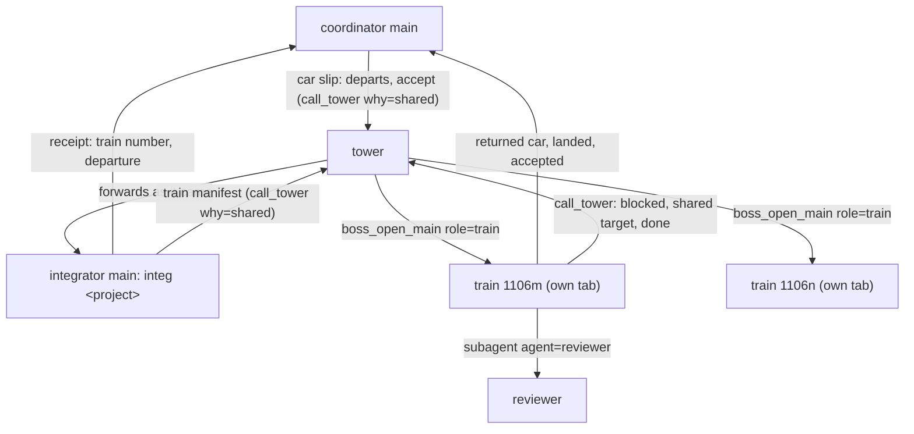
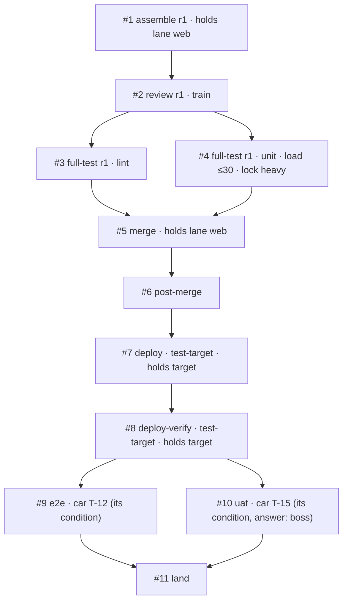

# Trains as their own workers

Status: decided, not built. Todo #125. Base `main` 9b2cbe48 (0.61.0). Extends [the merge train](2026-10-30-merge-train.md), [train stages](2026-11-05-train-stages.md) and [seam bindings](2026-11-06-seam-bindings.md). The boss answered the first round of decisions on 11/07 (section 1); the last question (section 16) on the same day. The boss's summary page is `~/.local/share/sbd-review/train-workers/decisions.md`.

## 1. The request and the decisions

The boss (verbatim, 11/07):

- 「我想把火車當成一種新的獨立 worker，這樣可以在 gui 上面也看到塔臺那邊的運送狀況（要求火車要建立 todo，然後用 todo 來顯示現在有幾個火車在互相等待），也能看出重新組裝的時候，如果監看格式統一，甚至可以看他們要求的負載」
- 「這樣我們的 sb net herdr plugin 的排序和 icon 也可以調整一下」
- 「火車的每一節 todo 也可以帶規格（可以用 sb 指令來確保規格，包括監看器的規格），分成 UAT or e2e、Full Test、Review 等等種類（你幫我規劃）」

Decisions (ask_user and the decision form, 11/07):

| # | Decision |
|---|---|
| B1 | A train is a worker of its own, a new role `train`, named like `train 1106m`. It runs its train from assembly to its last acceptance with its own todos. |
| B2 | Waits show through the todos: what a step waits for is readable from it, and the GUI draws the waits and counts them. |
| B3 | One monitor format: every command a train runs goes through `MonitorCreate` and reports e.g. `{"progress":{"load":{"max":30,"now":42}}}`; the GUI shows 「等負載 ≤30（現在 42）」 and each train's CPU need. `progress.message` is always present (§8.2). |
| D1 | 「獨立 agent，不需要綁定整合員。需要在 sb 記錄上看出他是火車而非一般 main agent」: the tower opens a train in a tab of its own (`boss_open_main` with the role `train`); it calls the tower itself; it does not count toward the tower's two opened mains, and the project's `maxTrains` limits it. Straw Boss's records (Herdr tokens, role records, the net, the registry, the work board) carry the role `train`, distinct from `main`. |
| D2 | 「整合員要設，可能我誤會了。我一開始以為成塔台了」: the integrator stays. It takes the cars and schedules trains (which train a car rides, when a new train is asked for). Once a train departs it runs on its own; the integrator does not supervise it. |
| D3 | Train codes are unique per project and shown as `MMDDx` (`2026-11-06-m` is `1106m`). |
| D4 | `maxTrains` defaults to 3 per project. |
| D5 | A named machine-wide lock, now, in the gate wrapper. |
| D6 | The sidebar: the integrator right under the tower, the trains by code; a row keeps its place while its state changes. |
| D7 | 「由 main agent 把貨物搬上車以後，指定出車條件。貨物的驗收條件 type 只是分類，流程中立。」: the coordinator loads its car and states on the slip when it may depart and what accepts it. A condition's kind (UAT, e2e, full-test, review, …) is a classification only: Straw Boss prescribes no flow per kind. A train waiting on a person's acceptance stays alive until its conditions say it is done. |
| D8 | 「每個 todo 都必須是一節，因此如果重新打包組裝，需要更新 todo」: every todo of a train is a step, and a re-assembly rewrites the train's todos. |
| D9 | Zen shows counts only. |
| D10 | No switch for the pilot. |
| D11 | A train whose open steps are all a person's acceptance does not count toward `maxTrains` (Q1, section 16). |

Straw Boss stays project-neutral: no environment is named here or in a prompt (train stages D3).

## 2. What exists today

- **The integrator does everything.** `prompts/integrator.md` makes one main per project carry every train through `merge`, `deploy`, `uat`, following pi-anchorloop 2.10.1's `integrating` and `deploying`. It keeps "one todo per train" and the ledger `trains/<project>/<app>.json`.
- **The ledgers are free text.** The four live ledgers of the pilot project (`trains/<project>/*.json` in the state folder, read only) hold 100 trains. `stage` is prose (`"deployed; boss UAT: all accepted except …"`), keys vary by train (`gates_run1`, `uat_page`, `deploy_verify`, a target's name as a key), and codes come in two forms (`1107g`, `2026-11-07-d`), each counted per app. One ledger names `"integrator": "integ v3 (tower-opened)"`: in practice several integrators ran per project. No reader can tell from a ledger which train waits on which.
- **Roles are two words.** `sb_role` is `main` or `member` on a pane (`tower` on a workspace token); 27 files in `src/` read it (`guard.ts`, `presence.ts`, `net.ts`, `opener.ts`, `closemain.ts`, `roles.ts`, `order.ts`, `link/routing.ts` among them). `boss_open_main` (`src/opener.ts`) opens at most `MAX_OPENED_MAINS` = 2 per workspace and one per sender, counted from live panes that carry `sb_opened_by`.
- **The GUI sees a todo list only in short.** A session's bridge sends `TodoSum` (`done`, `total`, `now`; `src/todo.ts`). `todosOf` (`src/items.ts`) drops `metadata`, `blockedBy` and `owner`, which rpiv-todo 2.15.0 keeps in its snapshot (`tool/types.ts` `Task`).
- **Monitors show their last line.** `trackMonitors` (`src/monitors.ts`) keeps the newest output line, cleaned and cut to 160 characters. pi-loop-monitor 0.2.8 sends at most one `monitor:output` per second, carrying only the latest line, so a status line followed by test output within the second is lost. Its JSONL parser takes `progress` only with a numeric `current` or `total` or a string `message`, and keeps just those keys: `{"progress":{"load":{...}}}` alone is no progress to it and does not renew the inactivity timeout (the 11/07 lesson: a redirected 25-minute test run was killed at its timeout).
- **pi lets a `tool_call` handler block a call or rewrite `event.input` in place** (pi 1.3.0 `ToolCallEventResult`). `src/hygiene.ts` and `src/runmode.ts` use the block; the guard below uses both.
- **Machine-wide admission is not built.** Procs release 2 (slots, `cli.mjs slot run|hold`, `docs/specs/2026-11-04-procs.md` §4) is designed only. Projects wait for load in their own words: one skill's `## Load` waits while the 1-minute load is above twice the core count and runs one heavy gate at a time across projects.
- **The sidebar.** The Herdr plugin (`herdr-plugin/`, id `wayne930242.straw-boss`, manifest 0.5.1) installs one view sorted by the `sb_order` token. Order and marks come from the tokens each session writes (`src/order.ts`): star for a main, person for a member, `[sub] <launcher>` for a subagent.

## 3. Roles



### 3.1 The coordinator (loads the car)

It builds the car slip as today and adds two lines (§5):

- `departs:` when the car may leave: with the next train, alone, with another car, not before a time, or by a time at the latest.
- `accept:` a conditions file: what accepts this car, each condition a step spec with its kind (§6). It checks the file with `cli.mjs train check --conditions <file>` before it sends the slip.

The kinds classify; the coordinator chooses which conditions its car needs, and the project skill's `## Light checks` and `## UAT` say what the project expects there.

### 3.2 The integrator (schedules)

Unchanged in identity: opened by the tower with `boss_open_main`, one per project, named `integ <project>`, closed after its idle `milestone`; it counts toward the tower's two opened mains as today.

It now does only this:

- Receives cars (`integrating` receive-car, which also re-runs `train check` on the conditions file) and answers each coordinator with the train number and the departure conditions.
- Forms trains: places each car on a forming train by its `departs` line and `integrating`'s train step 1 (`maxCars`, `maxWaitMin`, `Load`, a red pipeline), and departs a train when its conditions hold and the project has fewer than `maxTrains` active trains (§3.4).
- Departs by asking the tower: `call_tower` `why: shared` carrying one `train:` manifest (§5.3); the tower opens the train. The integrator's `train` todo for it completes when the tower answers with the opened train's session id.
- Keeps the project's index in the ledger (§10) and one `train` todo per forming train (§7.4).
- Reports idle when its queue is empty and no train it formed is waiting to be opened. Running trains do not keep it alive.

It does not watch, relay for, resume, or close a train. A car a train returns comes back as a new slip from its coordinator.

### 3.3 The train

A session of its own role, opened by the tower:

```text
boss_open_main({ role: "train", request: <the manifest verbatim>, sender: <integrator>, label: "train 1106m" })
```

- **Who opens it.** The tower only, on an integrator's manifest. A coordinator never asks for one, and a train never asks for another.
- **Where.** A new tab in the tower's own workspace, as an opened main; the train works in `~/.herdr/worktrees/<repo>/train-<code>`.
- **Quota.** The workspace's two opened mains do not count it, and it does not count toward them. The open is refused when the project already has `maxTrains` active trains (§3.4), counted from live panes with `sb_role=train` and the project's trainboards, so the limit survives a tower restart as the main limit does.
- **Records.** Its pane carries `sb_role=train` and `sb_train=<project>/<code>`, and `sb_opened_by` as an opened main does. It is no main and no member: the guard crowns nobody in a train's tab, `boss_promote` is refused there, and a pi started later in that tab stays a member that the train does not command. Its role record (`roles/<hash>.json`) holds `role: "train"`, the project and the code, so a Herdr restore brings it back as a train with the main's terminal proof. The net shows it as a unit with `role: "train"` and its registry ref carries the same; its work-board entry carries `role: "train"`, which `board_read`, `tower_list` and `boss_status` show.
- **Name.** `train <MMDDx>`, set by the open and never renamed (`boss_rename` is refused in the role).
- **Prompt.** Its system prompt is `prompts/train.md`, not `main.md`; it ends with its own `## Seam bindings` block (§13), so the session holds exactly one, as `integrating` requires.
- **What it does.** It answers each car's coordinator that the car rode out with it, writes its steps as todos (§6, §7), runs them, answers the coordinators (a returned or red car, "landed in …", "accepted"), dispatches its reviewer as the `reviewer` role, opens a UAT page with `show_doc`, and asks the boss with its question tool where `Approval` says so. It calls the tower itself: `blocked`; `shared` naming a target before a deploy it starts; `milestone` when done.
- **Done.** When every car has every acceptance step passed, or has been returned, and the train's own steps are complete. A train waiting on a person's acceptance stays alive until then (D7). It then reports `milestone` to the tower and waits; the tower closes it with `boss_close_main`, which accepts the `train` role on the same checks as an opened main (§12 of how-it-works, "Closing an opened main").
- **Hygiene.** A train registers with the sb server as an owner (`procs-hello` with `role: "train"`), as a worker does, so what its gates leave dies with it.

### 3.4 Concurrency

- **`maxTrains`** (top-level `integration`, default 3): the project's active trains. A train is active while it holds or waits for a lane or a target, or runs a step with a command; one whose open steps are all `answer` checks (a person's acceptance) holds nothing. That one does not count toward the limit (D11); it is listed apart as waiting on acceptance.
- **Holds.** A step may declare `holds` (§6.1): `lane` (an app's integration branch) or `target`. A train holds a lane or target from the start of the first step that declares it until every step of the round that declares it has completed. A later train's step that declares the same hold waits (§7.3). Which steps declare which hold is the project skill's and `integrating`'s (one train per integration branch from assembly to its merge; one per target from its deploy to its verify), not a rule of any kind.

### 3.5 Re-assembly

A dropped car starts a new round, and the todos say so (D8):

1. The train waits for the running monitors of round `n` to end (or stops them), then completes every step of the dropped car as `void` with `why: "dropped"`.
2. Every other step of round `n` that has not passed, and every passed step whose `on.head` is round `n`'s head, is completed as `void` with `why: "superseded"`. A passed step against something that did not change (a version already deployed) stays.
3. It creates `assemble` for round `n+1`, whose spec lists the cars kept and `removed`: each dropped car, why, and the evidence (failing tests and log path, or a review finding).
4. It creates round `n+1`'s steps again against the new head; a car's acceptance steps keep their conditions file's spec, with the new `on`.
5. It tells the dropped car's coordinator (`integrating` train step 5). The car comes back, reworked, as a new slip to the integrator.

A post-push revert goes as its own train (`deploying` rollback step 5), formed by the integrator.

## 4. One train in todos



`blockedBy` orders the steps inside one train (rpiv-todo checks it within one list). The order is the train's, from `integrating`, `deploying` and the project skill; Straw Boss reads only each step's spec and evidence.

## 5. What the slip and the manifest carry

### 5.1 Two new slip lines

```text
departs: next | alone | with <ticket or branch> | after <ISO time> | by <ISO time>   (several, comma-separated)
accept: <conditions file> | none
```

- `next` (the default) rides the next train of its app. `alone` rides a train of its own. `with` waits for the named car, at most `maxWaitMin`. `after` does not leave before the time; `by` leaves no later than the time, even below `maxCars`, while `Load` and a red pipeline still hold it.
- `accept` replaces the `uat:` line: a UAT checkpoints file is now referenced by a condition of kind `uat` (§6.2). A car with no conditions is accepted by the train's own steps alone.

### 5.2 The conditions file

```json
{ "v": 1, "car": { "app": "web", "tickets": ["T-15"], "branch": "fix/t-15", "head": "<40 hex>" },
  "conditions": [
    { "kind": "uat", "name": "order form", "check": { "type": "answer", "from": "boss", "what": "accept the order form checkpoints", "checkpoints": "<path>", "accepts": ["accepted"] }, "on": { "target": "test-target" } },
    { "kind": "e2e", "name": "checkout", "check": { "type": "run", "cwd": "<app dir>", "run": "<command>", "log": "<path>" }, "on": { "target": "test-target" }, "load": { "max": 30, "weight": 2 } }
  ] }
```

Each condition is a step spec without the train's fields (`train`, `round`, the resolved `on.head`); `train check --conditions` validates it with the step validator (§7.1). The file is at most 32 KB.

### 5.3 The manifest

The integrator's `train:` block, which the tower passes verbatim as the open's request: `project`, `app`, `code`, `base`, `stages`, `targets`, `skill`, the integrator's session id, and each car's slip verbatim with its conditions file. The tower copies nothing; the train copies each conditions file into its trainboard folder at its start (`car-<n>.json`), and the guard compares each car's steps with that copy, so a condition cannot be weakened after the slip was checked.

## 6. Steps

### 6.1 The step spec

Every todo of a train carries one object under `metadata.sb`; nothing else of a todo is Straw Boss's.

```json
{
  "sb": {
    "v": 1, "project": "acme", "app": "web", "train": "2026-11-06-m", "round": 1,
    "kind": "full-test", "name": "unit", "car": "train",
    "spec": {
      "check": { "type": "run", "cwd": "~/.herdr/worktrees/web/train-2026-11-06-m", "run": "<the gate's command>", "log": "<path>" },
      "on": { "head": "<40 hex>" },
      "load": { "max": 30, "weight": 4 },
      "lock": "heavy",
      "holds": { "lane": "web" }
    },
    "result": { "outcome": "passed", "evidence": "<one line>", "at": "2026-11-07T08:40:00Z" }
  }
}
```

- `kind` is one of §6.2's words, `name` tells apart steps of one kind (two gates, two targets), and `car` is the car's first ticket, or `train` for a step of the whole train.
- `check` says how the step passes (§6.3); it is the one required part.
- `on` is what the check is against: `{ head }` (a commit) or `{ target, version }` (a deployed result). It is required for every check except an `answer` with no target, and it decides what a re-assembly voids (§3.5).
- `load` is `{ max }` (a load average) or `{ perCore }` (resolved against the core count where it runs), with an optional `weight`, the cores the step expects to use (the slot weight of procs release 2). It is the CPU need the GUI shows. Only a `run` check takes it.
- `lock` is a name of the machine-wide lock (§9.1); only a `run` check takes it.
- `holds` declares a lane or a target (§3.4).
- `result` is set only on `completed`: `outcome` is `passed`, `failed`, or `void` (with `why`: `dropped`, `superseded`, or `skipped`). rpiv-todo has no failed state, so a failed step is `completed` with `outcome: "failed"`, and the GUI colors by outcome.
- `project` and `app` are path-safe names (letters, digits, `.`, `_`, `-`; 1 to 64 characters); `train` is `YYYY-MM-DD-<letters>`; `metadata.sb` is at most 8 KB as JSON.

### 6.2 Kinds: a classification

The kind names the step for the GUI, the sidebar, and the counts; it decides nothing about order, check, or holds (D7). The set is closed, so a reader can name every step.

| Kind | 中文 | Usually | Typical check (guidance only) |
|---|---|---|---|
| `assemble` | 組裝 | `## Train assembly` | `git` |
| `review` | 審查 | the train's review, or a car's | `report` |
| `full-test` | 全測 | `## Full gates`, one step per gate | `run` |
| `e2e` | E2E | an automated end-to-end run | `run` |
| `uat` | UAT | a person's acceptance | `answer` |
| `merge` | 合併 | `## Merge` | `run` |
| `post-merge` | 合併後 | `## Post-merge` | `run` |
| `deploy` | 部署 | `## Deploy` | `run` |
| `deploy-verify` | 部署驗證 | `## Deploy verify` | `run` with `expect` |
| `rollback` | 回滾 | `## Deploy`'s rollback | `run` with `expect` |
| `land` | 落地 | telling each coordinator "landed" or "accepted" | `report` (the ledger file that lists each notice sent) |
| `other` | 其他 | anything else the project names; needs `label` (1 to 40 characters) | any |

A test scans the prompts and the code for exactly this set.

### 6.3 Checks: how a step passes

The check type is what Straw Boss enforces, whatever the kind.

| Type | Spec | Runs through | Passes when (the guard checks it) |
|---|---|---|---|
| `run` | `cwd`, `run`, `log`; optional `verify` (a command after `run`), `expect` (the last stdout line of `verify` must equal it), `poll` (`everySec`, `forMin`, for `expect`) | `MonitorCreate`, rewritten to the wrapper (§8) | the wrapper's outcome for this frozen spec is `passed` |
| `git` | `cwd`, `contains` (commits that must be ancestors), optional `ref` | the guard itself | `git -C cwd` shows `result.head` as `HEAD` (or `ref`), every `contains` commit is its ancestor, and `on.head` equals `result.head` |
| `report` | `path`, `expect` (the verdict, such as `P0=0 P1=0`) | a subagent or the session | the file exists, is not empty, changed after the step went `in_progress`, and `result.verdict` equals `expect` |
| `answer` | `from` (`boss`, `coordinator`, `tower`), `what`, optional `checkpoints`, `page`, `accepts` (verdicts that pass, default `["accepted"]`) | the session (question tool, `show_doc` form, intercom) | `result.quote` is a substring of a message on the session's branch that came from outside it (a user message, a form answer, an intercom or tower message), `result.from` is `from`, and `result.verdict` is in `accepts` |

A step whose check failed completes `failed`; the train then follows `integrating`'s red handling and `deploying`'s rollback, which are the skills', not Straw Boss's.

## 7. The guard: sb checks a spec before a step starts

`src/trainguard.ts`, a `tool_call` handler in the Straw Boss extension. In a session with the role `train` it handles every `todo` and `MonitorCreate` call; in the integrator, only `todo` calls that carry `metadata.sb`. It reads the session's todo list from its branch (as `todosOfBranch` does, with metadata) and applies the call to a copy before deciding, so a batch create, an `addBlockedBy`, and a metadata patch (`null` deletes a key) are judged as they would land. A refusal blocks the call; the list does not change, and the model reads the reason.

### 7.1 `todo` calls

| Check | Refusal |
|---|---|
| A train's todo carries `metadata.sb` (D8) | `sb: every todo of a train is a step: add metadata.sb (kinds: assemble, review, full-test, e2e, uat, merge, post-merge, deploy, deploy-verify, rollback, land, other)` |
| `kind` is in the set | `sb: kind "<x>" is not a step kind (…)` |
| The common fields hold (§6.1) | `sb: metadata.sb.<field> <what is wrong>` |
| The check's fields are present and well formed (§6.3) | `sb: a <type> check needs <field>` |
| `train`, `project`, `app` are this train's, and `round` its current round | `sb: step #<id> names train <x>, round <n>; this train is <y>, round <m>` |
| A car's step matches a condition of that car's copied file, `on` aside | `sb: step #<id> does not match condition "<name>" of car <ticket>` |
| Every condition of every car still on the train has a step in the current round, before any step of that round completes `passed` | `sb: car <ticket>'s condition "<name>" has no step in round <n>` |
| A new round's `assemble` comes after every step of the old round has completed | `sb: round <n> still has step #<id> <status>; complete it (void) first` |
| `completed` carries `result`, and `passed` meets the check (§6.3) | `sb: step #<id> passes only when <criterion>; <what is missing>` |
| A `run` step completes `passed` only after its monitor ended `passed` for this spec | `sb: step #<id> has no passed run of its spec (last: <state>)` |
| `metadata.sb` within 8 KB | `sb: metadata.sb is <n> KB, more than 8` |

### 7.2 `MonitorCreate` calls

A train's monitor runs exactly one `run` step. The model calls `MonitorCreate` with `description: "train <code> #<step id> <kind>"` and `command` set to the step's `check.run` verbatim. The guard then:

1. Checks that step `#<id>` exists, is this train's, is `in_progress`, has a spec that passes §7.1 and a `run` check, that `command` equals `check.run`, and that no monitor of the step runs. Refusals: `sb: a train's monitor runs one step: describe it "train <code> #<id> <kind>"`, `sb: step #<id> runs "<check.run>", not this command`, `sb: step #<id> is <status>; a monitor starts only for an in_progress step`, `sb: step #<id> already has a running monitor (#<monitor>)`.
2. Freezes the spec into `<state>/trainboard/<project>/<code>/step-<id>.json` (mode 600).
3. Rewrites `event.input.command` to the wrapper, `'<node>' '<cli.mjs>' train gate --spec '<that file>'`, and sets `timeout` to at least 120000 ms (the wrapper prints a line every 30 s, so the inactivity timeout never ends a long gate). `description` stays, so the bridge's monitor list and the trainboard join on it.

This is the monitor spec the boss asked sb to enforce: the description names the step, the command is the step's, and the lines follow §8.2 because the wrapper writes them. A gate cannot run outside it in a train. Heavy commands run through plain `bash` are not caught; procs release 2's heavy-command hook is where that belongs (§17).

### 7.3 Waits

Straw Boss derives every wait from the spec; the model writes none.

| Wait | From | Resolved when | Who checks | The GUI says |
|---|---|---|---|---|
| load | `load` | the 1-minute load average is at most the limit | the wrapper, every 30 s | 等負載 ≤30（現在 42） |
| lock | `lock` | the named lock is free | the wrapper | 等鎖 heavy（train 1107d 持有） |
| lane | `holds.lane` | no earlier train holds the lane | the wrapper, or the guard at `in_progress` for a step without a monitor | 等 1106l 合併道（web） |
| target | `holds.target` | no earlier train holds the target | as lane | 等 1106l 部署目標（test-target） |
| answer | an `answer` check | the step completes | the model | 等老闆回覆：… |

"Earlier" is by departure order (the code), so two trains never wait on each other in a cycle. Holding is computed from the trainboards by one pure function (`holders`, §11.1). A trainboard that cannot be read, and the board of a train whose session is gone without ending (§10), hold what they held: the wait says why, and only `train clear` (§9.3) releases it. 「互相等待」 in the GUI is the count of trains with a lane or target wait held by another train.

### 7.4 The integrator's `train` todo

```json
{ "sb": { "v": 1, "project": "acme", "app": "web", "train": "2026-11-06-m", "kind": "train",
  "spec": { "cars": [{ "tickets": ["T-12"], "branch": "fix/t-12", "head": "<40 hex>", "coordinator": "<session id>", "departs": "next", "accept": "<path>", "arrived": "…" }],
            "departs": { "maxCars": 4, "maxWaitMin": 60, "oldest": "…" } } } }
```

`pending` while the train forms, `in_progress` from the manifest's `call_tower`, `completed` when the tower answers (`result.outcome` `passed` with the train's session id, or `failed` with the refusal). The guard checks its fields and that each car's conditions file validates.

## 8. The wrapper and the monitor format

### 8.1 `cli.mjs train gate --spec <file>`

The process `MonitorCreate` runs. It reads the frozen spec (refusing, exit 3, one that does not validate), then:

1. **Waits** while a load, lock, lane, or target wait of the step is unresolved, rechecking every 30 s and printing a `waiting` line each time.
2. **Runs** `run` in `cwd` through the shell as a child in a process group of its own, with stdout and stderr appended to `log`. It holds a lock in this parent process for the child's life (not `exec`: the lesson of a lock dropped across `exec`). It prints a `running` line every 30 s with the elapsed time, the load now, and the log's last line cleaned and cut to 200 characters.
3. **Verifies**: after `run` exits 0 it runs `verify` when the spec has one, and compares its last stdout line with `expect`, polling as `poll` says.
4. **Ends** with one outcome line and an exit code: 0 `passed`, 1 `failed`, 3 `refused`, 143 `stopped` (SIGTERM: it sends SIGTERM to the child's group, SIGKILL after 10 s, releases the lock, and says so).

Beside its stdout it writes `<state>/trainboard/<project>/<code>/gate-<id>.json` on every line: state, since, load now, the holder it waits on, pid and start time. The server reads that file (§11.1), so the GUI does not depend on which stdout line pi-loop-monitor happened to pass on.

### 8.2 The line format

One JSON object per line, at most 1000 characters, and nothing else on stdout:

```json
{"progress":{"message":"waiting: load <=30 (now 42)","load":{"max":30,"now":42}},"sb":{"v":1,"train":"2026-11-06-m","step":4,"kind":"full-test","state":"waiting","waits":[{"load":{"max":30,"now":42}}],"since":"2026-11-07T08:00:00Z"}}
{"progress":{"message":"running 12m: unit (load 18)","load":{"max":30,"now":18}},"sb":{"v":1,"train":"2026-11-06-m","step":4,"kind":"full-test","state":"running","since":"2026-11-07T08:12:00Z","tail":"✓ 1204 tests"}}
{"monitorOutcome":{"status":"passed","message":"exit 0 in 18m3s"},"sb":{"v":1,"train":"2026-11-06-m","step":4,"kind":"full-test","state":"passed","exit":0}}
```

- `progress.message` is always present, so pi-loop-monitor counts every line as progress and renews the inactivity timeout; `progress.load` is the boss's shape. `message` is English for the model; the GUI words the wait itself from the fields (§11.2).
- `sb.state` is `waiting`, `running`, `verifying`, `passed`, `failed`, `refused`, or `stopped`; `monitorOutcome.status` is the same word, so `onSignal` and `onDone` see the end.
- Every line carries the whole state, so the latest line alone is enough wherever only the latest line arrives.
- `src/monitors.ts` learns the format for every monitor, not only trains': a line that parses as `{progress: {message}}` shows its `message` as the monitor's last line instead of raw JSON, and `progress.load` is kept as `load` on the `Monitor` (checked by `monitorsOk`).

## 9. The other `train` commands

### 9.1 The lock (D5)

The wrapper takes a named lock under `<slot dir>/locks/<name>.lock`, holding an open descriptor with `flock` in its own process for the child's life, with its holder (train, step, pid, start time) beside it in `<name>.json`. Names are `[a-z0-9-]{1,32}`. A holder whose pid is gone or reused loses the lock at the next look. Procs release 2's slots take over the same names later.

### 9.2 Commands

| Command | Effect |
|---|---|
| `train check (--step <spec.json> \| --conditions <file>)` | Validates one step's `metadata.sb`, or a car's conditions file, with the guard's validator; prints the refusals, exit 2 when any. The coordinator runs it before it sends a slip. |
| `train status [--project P] [--json]` | Every train on this computer from the trainboards: project, app, code, session (live or gone), round, steps with state, the waits with their holders, the load each needs, and the locks held. `/boss trains` shows the same in a session. |
| `train clear --train <code> --project P (--lane <app> \| --target <name>) --reason TEXT` | Releases what a train whose session is gone still holds, writing who cleared it and why into its trainboard. Refused while the train's session is live. Run only after reading the target's version with the project's `Deploy verify`; when it cannot be read, the asker calls the tower `blocked` instead. |

## 10. Trainboards and the ledger

Two kinds of file, one writer each:

- **The ledger** stays the model's (the Record seam): `trains/<project>/<app>.json` keeps the queue and an `index` (code, train session, file, state), written by the integrator; `trains/<project>/<app>/<code>.json` holds one train (cars, SHAs, review, gates, versions, verdicts), written by the train. One writer per file ends the race between several sessions on one JSON file. Old entries stay where they are.
- **The trainboard** is Straw Boss's derived state, as the work board is: `<state>/trainboard/<project>/<code>/board.json` is written by the train's extension from its todo list after every `todo` call and turn end (atomic rename, folder 700, file 600); `<state>/trainboard/<project>/yard.json` by the integrator's from its `train` todos. Each holds `v`, `project`, `app`, `code`, the writer (session id, pane, pid, start time), `updated`, `round`, `cars`, and each step's id, kind, name, car, status, round, holds, derived waits, and outcome. The copied conditions files, the frozen `step-<id>.json`, and the wrapper's `gate-<id>.json` sit beside it.

A trainboard outlives its session on purpose: a train that waits on an acceptance after a crash, or holds a target, stays visible and keeps its holds. It is `ended` when its `land` step completed, and `stale` when its writer is gone and it was not updated for 10 minutes. The server deletes an ended trainboard 7 days after its last update; a stale one only after `train clear` and the same 7 days.

## 11. The GUI

### 11.1 Data

- `src/server/trainyard.ts` reads `<state>/trainboard/*/` on the net's read (at most 64 trains, 64 KB per file, the writer's validator; a file that fails is shown as unreadable, never guessed), computes `holders` and each train's waits, and adds `yards` to the snapshot: per project the forming trains and their cars (from `yard.json`), and every train with the unit key of its session, so the page can open its comms.
- `net.load`: the server's 1-minute load average and core count, for the header chip.
- A train is a unit with `role: "train"` and `train: { project, code }` in its tab.
- `yards` stay on this computer: they are not part of the `board` message, a remote turn, or the operate slice of [link-operate](2026-11-07-link-operate.md). A train's work-board entry goes to allies as a main's does (its name and done count).

### 11.2 What the page shows

- **The yard** (調車場), one per project, opened from a chip on the base header (「火車 3（等待 2）」) and from the integrator's card, so it stays reachable after the integrator closed: the forming trains with their cars and departure conditions (「滿 4 節或 60 分（還 23 分）」, 「T-15：單獨出車」); then one row per train: code, app, the cars' tickets, the round (「第 2 次組裝：移除 T-12（unit 紅）」), its steps as pills by kind (組裝、審查、全測、E2E、UAT、合併、合併後、部署、部署驗證、回滾、落地、其他) colored by state and outcome, each car's acceptance steps grouped under the car, the wait in words (§7.3), and the load it needs (「需負載 ≤30，約 4 核」). The header: 「3 列火車：1 運行、2 等待（互相等待 1）」 and 「負載 42／14 核」.
- **A train's unit card** uses the locomotive icon; its note line is the current step and its wait. Its tab shows on the map as any tab.
- **Zen**: the strip adds the train count and the waiting count only (D9).
- **Language**: zh-TW first, English; the kind words, wait words and counts are paraglide messages.
- **Icon**: game-icons.net "Steam Locomotive" (Delapouite, CC BY 3.0) for a train, added to `gui/ICONS.md` and the sprite; check the file exists before task 7 starts.

## 12. Herdr: tokens, order, and the plugin

The plugin sorts by `sb_order` and changes no code; order and marks come from the tokens (`src/order.ts`), so the work is there plus the documented `config.toml` snippet.

| Row | `sb_order` | `sb_mark` | `sb_name` | `sb_step` (new) |
|---|---|---|---|---|
| Tower | `WWW.0` | none | none | none |
| Tower's subagents, ally runs | `WWW.0.NNN` | as today | as today | none |
| Integrator | `WWW.05.0.PPP` (its tab moved up; its members `WWW.05.1.PPP`) | code-fork, U+F126 | none | none |
| Train | `WWW.06.YYMMDDLL`, `LL` the code's letters left-padded with `0` (`261106` + `0m`) | train, U+F238, and the short code (`\uF238 1106m`) | none | state glyph and kind, at most 24 characters |
| Its reviewer | one segment more, as any subagent | `[sub] train 1106m` | `reviewer` | none |
| Other tabs | `WWW.1.TTT.R.PPP` | as today | as today | none |

- `.` sorts before digits, so the tower's own subagents come before the integrator, and `WWW.05`, `WWW.06` both come before the tabs (`WWW.1…`). A code key does not move when another train ends, so a row keeps its place (D6) and `focus_agent` numbers move only when a row comes or goes.
- `sb_step` glyphs: hourglass U+F254 waiting, play U+F04B running, check U+F00C passed, times U+F00D failed, bell U+F0F3 waiting on an answer (not the person U+F007, which marks a member). The train writes it on its own pane when its current step changes (debounced 5 s), besides its 4-minute refresh.
- The integrator is known by the `train` todos on its list (`yard.json` names its session); a train by its `sb_role`.
- The documented row snippet gains `{ token = "$sb_step" }` after `$sb_name`, and rules for `\uF126` and `\uF238` (bold). The plugin's manifest version moves only if its files change.

## 13. Prompts and skills

### 13.1 Straw Boss prompts

| File | Change |
|---|---|
| `prompts/integrator.md` | The scheduler of §3.2: receipt (re-run `train check`), placing cars by `departs`, departure under `maxTrains`, the `train:` manifest through `call_tower` `why: shared`, the `train` todo with `metadata.sb`, the idle condition; no supervision of a running train. Budget 340 to about 380 words. |
| `prompts/train.md` (new) | The train: one train; its tab; every todo a step with `metadata.sb` (§6); kinds classify and the order comes from `integrating`, `deploying` and the project skill; a `run` step through `MonitorCreate` described `train <code> #<id> <kind>`; rounds and void steps on re-assembly; answering coordinators; `call_tower` for `blocked`, `shared` naming a target, and `milestone` when done; the UAT page; the name never changes. It ends with its own `## Seam bindings` block, seven lines (§13.2). Its system prompt; budget about 480 words. Inside the integration markers as a whole: with the switch off the role is refused at the open. |
| `prompts/main.md` | Seam bindings: Batch owner reads "the project's one integrator main schedules trains; each departed train runs in a `train` session the tower opens"; Record names the index and the per-train files; Handoff route adds that the train answers a car after the integrator's receipt. Still six lines. Budget on 700 to about 720. |
| `prompts/planning.md` | A coordinator's car carries `departs` and an `accept` file whose conditions it chooses and checks with `train check`; a condition's kind is a classification. Budget unchanged (trim elsewhere). |
| `prompts/apps-config.md` | `integration.maxTrains` (top level, default 3). |
| `prompts/tower.md`, `tower-run.md` | A `shared` request from the integrator with a `train:` block is no go: open the train with `boss_open_main` role `train`, the manifest verbatim, once per code; a train is no main and does not count toward the two; its `shared` naming a target is checked for a clash like the integrator's deploy; close it after its done `milestone`, unless it says it waits on the boss. |

### 13.2 pi-anchorloop (`wayne930242/anchorloop`), for 2.11.0

- `references/seams.md`: a seventh seam, **Step runner**: how a train's steps are recorded and how a step that runs a command starts, waits for load, locks and holds, and reports its state and outcome. Default: the owner's one todo per train, each heavy check in the session's own shell after `Load`'s wait.
- `references/seams.md`, Batch owner: "may schedule trains and give each departed train to a session of its own, which then owns it to the end"; Record: "one file per app, or an index per app and one file per train"; the ledger section says the same.
- `integrating/playbooks/receive-car.md`: the slip's `departs` and `accept` lines (§5.1), replacing `uat`; the owner checks the conditions file. A condition's kind classifies it; the project skill's headings say what a project expects.
- `integrating/playbooks/train.md` step 1 departs by the cars' `departs` lines too; steps 2 to 4: one train per integration branch holds it from assembly to its merge; each car's conditions become steps of the train; each gate through the Step runner. Step 6: a re-assembly voids the dropped car's steps and the old head's, and recreates the rest.
- `deploying`: each command of deploy, verify, and rollback through the Step runner; one train per target holds it from its deploy to its verify; the UAT stage runs the cars' `uat` conditions.

Straw Boss binds the Step runner in `train.md`: "every step is a todo with `metadata.sb` (this prompt); a step that runs a command runs as `MonitorCreate` described `train <code> #<id> <kind>` with `command` its `check.run`, which Straw Boss wraps, and whose lines report `{progress: {message, load}}` and the outcome". Straw Boss then requires pi-anchorloop 2.11.0 or newer (README, the `blocked` lines of `integrator.md` and `train.md`).

## 14. Migration

1. pi-anchorloop 2.11.0 is released first; this Straw Boss release requires it.
2. A running integrator picks up the new prompts at its next `/reload` or restart. A train already in its ledger with no trainboard is a legacy train: the integrator finishes it itself, the old way; every departure after that opens a train session.
3. A slip without `departs` departs `next`; one with `uat:` and no `accept:` is returned with the new format named, since a checkpoints file alone carries no check.
4. The live ledgers are not rewritten. New trains add `index` entries and per-train files; old `trains` entries stay as history.
5. One integrator per project: where several ran per app, the tower's rule already holds for new openings; the extra ones go idle and are closed as usual.
6. A project skill needs no change to work. It reads better when `## Load` gives a number or a per-core factor, `## Full gates` lists its gates one by one, and `## Light checks` or `## UAT` says which conditions a car is expected to carry; that is the project's change.
7. With the merge train off nothing of this loads: no role, no guard, no trainboard, no `yards`; a `boss_open_main` with role `train` is refused with "integration is off on this computer".

## 15. Tasks

Every task is red first; its anchor is `npm run check && npm test` plus its files through `npm run test:one`. GUI key tests also run with a Linux `navigator.platform`, and a post-merge check includes `tests/imports.test.ts`.

| # | Task | Files | Red tests | Depends on | Fresh review |
|---|---|---|---|---|---|
| 0 | Spike, nothing merged: (a) rpiv-todo's snapshot keeps `metadata`, and a `tool_call` handler sees and can block `todo` input; (b) pi-loop-monitor 0.2.8 runs a `command` and `timeout` rewritten in `tool_call`; (c) a pi in a tab idles for hours waiting on a `show_doc` form answer, and the answer reaches that session as a message the guard can find on its branch; (d) the 27 readers of `sb_role` listed with what each does with an unknown value | scratch notes in the plan folder | — | none | No |
| 1 | The contract, pure: kinds, check types, `metadata.sb` and conditions-file schemas, slip lines `departs` and `accept`, the validator and its refusal words, holds and `holders`, wait derivation, the trainboard format (read, write, caps) | new `src/train/spec.ts`, `src/train/waits.ts`, `src/train/board.ts` | `tests/train-spec.test.ts` (every check type's fields, every refusal word, a kind decides nothing: the same check under each kind passes the same, a metadata patch with `null`, a batch create, a car step that differs from its condition), `tests/train-waits.test.ts` (holds from first declaring step to last, earlier-only order so no cycle, an unreadable or stale board holds, `clear` releases), `tests/train-board.test.ts` | 0 | Yes (shared contract) |
| 2 | The wrapper, the lock and the CLI: `train gate|check|status|clear`, the line format, the gate file, SIGTERM | new `src/server/traingate.ts`, `src/server/trainlock.ts`, `src/server/cli.ts` | `tests/train-gate.test.ts` on a fake clock and load source: waits then runs, a line every 30 s and each with `progress.message`, `verify` and `expect` with `poll`, exit codes, a lock held across the child and released on SIGTERM, a dead holder loses the lock, a child group killed, no line over 1000 characters; real children only inside the test root | 1 | Yes (processes, locks) |
| 3 | The role `train` in Straw Boss's records: `boss_open_main` with `role: "train"` (its own count per project against `maxTrains`, not the two; once per code), `sb_role=train` and `sb_train`, the guard and promotion in a train's tab, role records and restore, `boss_close_main` for a train, presence and the net (`role: "train"`), refs, board entries and `board_read`, `tower_list`, `boss_status`, the readers of `sb_role` from 0(d), hygiene's hello | `src/opener.ts`, `src/bossopen.ts`, `src/guard.ts`, `src/membership.ts`, `src/roles.ts`, `src/closemain.ts`, `src/presence.ts`, `src/net.ts`, `src/board*.ts`, `src/hygiene.ts`, `src/server/procs.ts`, others from 0(d) | `tests/train-open.test.ts` (opens beside two opened mains; the fourth train of a project refused; the same code twice refused; off refused), `tests/train-tab.test.ts` (no crowning, promote refused, a later pi stays a member), restore cases in the roles tests, `tests/net.test.ts` and board tests (role `train` shown, never as a main), close accepted for a train and refused for a busy one | 1 | Yes (roles, closing rights) |
| 4 | The train's session: `train.md` as its system prompt, the guard (`todo` with conditions comparison, `MonitorCreate` rewrite, completion evidence for each check type), the conditions copy at start, the trainboard writer, `sb_step`; the integrator's `train` todo check | new `src/trainguard.ts`, `src/trainboard.ts`; `src/session.ts` (prompt choice), `src/items.ts` (`todosOf` keeps `metadata.sb`) | `tests/train-guard.test.ts` (every refusal of §7, a rewrite that keeps `description`, a `run` pass refused without a passed run, a `git` pass read from a real repository in the test root, a `report` pass refused for a file older than the step, an `answer` pass refused when the quote is not on the branch, a re-assembly that leaves a step open refused), `tests/trainswitch.test.ts` additions | 1, 2, 3 | Yes (enforcement) |
| 5 | Server and net: the trainyard reader, `yards` and `load` in the snapshot, monitor progress for every monitor | new `src/server/trainyard.ts`; `src/net.ts`, `src/monitors.ts`, `src/dialogs.ts` | `tests/server-trainyard.test.ts` (server world: two projects, forming and running trains, a stale board, a hostile file refused, the train's unit key joined), `tests/monitors.test.ts` (a JSON progress line shows its message and keeps `load`) | 1, 4's board | With 4 |
| 6 | Herdr tokens and the snippet: the integrator's key and mark, the train keys and marks, `sb_step` | `src/order.ts`, `src/herdr.ts`, `docs/how-it-works.md` Sidebar net view | `tests/order.test.ts` (tower subagents, then the integrator, then trains by code, then tabs; a train ending moves no other row; a reviewer under its train; two-letter codes after one-letter ones) | 3 | No |
| 7 | The page: the yard, the base chip, the train icon and card, Zen's count, strings, demo states | `gui/trains.ts` (pure model), `gui/yard.ts`, `gui/ICONS.md`, `index.html` sprite, messages | `tests/gui-trains.test.ts` (counts, 互相等待, wait words, round text with the removed car, conditions grouped by car, load need); `visual-tester` for Standard, Geek, Zen and the phone width | 5 | No (anchor + visual check) |
| P | pi-anchorloop 2.11.0: the Step runner seam, Batch owner and Record wording, the slip's `departs` and `accept` lines, lanes and targets as holds, re-assembly voiding | anchorloop `skills/integrating/references/seams.md`, `SKILL.md`, `playbooks/receive-car.md`, `playbooks/train.md`, `skills/deploying/` | that repository's own tests | none (wording fixed by §13.2) | Yes (shared contract) |
| 8 | Prompts | `prompts/integrator.md`, new `prompts/train.md`, `main.md`, `planning.md`, `apps-config.md`, `tower.md`, `tower-run.md` | `tests/prompts.test.ts`: budgets on and off; `train.md`'s block of seven lines in the order of `seams.md`, directly at its end; `main.md`'s six; every kind of §6.2 named in `train.md`; no environment named; the tower prompts name `role: "train"` and the manifest | 3, 4, P | Yes (with P) |
| 9 | Docs and release: `how-it-works.md` Merge train, Opening a main, the work board and GUI sections; README (pi-anchorloop 2.11.0); this record's status; a minor release | — | full suite, then CI | 1 to 8 | One fresh reviewer over the whole change-set before release (roles, enforcement, shared contract) |
| 10 | Pilot in one project: first an app with `merge` only, then one with `deploy` and a `uat` condition | the project's integrator and coordinators; no Straw Boss files | The acceptance list of §18 | 9 and the boss's go for the project | — |

Order: 0, then 1. Tasks 2, 3 and P run in parallel worktrees from 1's commit (P needs none of it). 4 follows 2 and 3; 5 and 6 follow 4 and 3; 7 follows 5; 8 follows 4 and P.

## 16. Decided last

| # | Question | Answer |
|---|---|---|
| Q1 | Does a train whose open steps are all a person's acceptance (`answer` checks, no lane or target held, no command running) count toward `maxTrains`? | No (the boss, 11/07): it holds nothing another train needs and uses no CPU; its tab and its pi stay until the verdict (D7). |

## 17. Not built, and limits

- Heavy commands a train runs through plain `bash` are not wrapped; procs release 2's heavy-command hook is the place.
- On Windows the load average is not available: the guard refuses a `load` spec there with that reason.
- Claude Code and Codex sessions cannot be trains (no rpiv-todo, no `MonitorCreate`); they can still be coordinators, and a sidecar coordinator runs `train check` like any other.
- Yards do not cross Straw Link.
- The guard trusts what `verify` prints and what a `report` says: the project skill owns the command that reads a target's version and the reviewer's verdict line.
- An `answer` check proves that the quoted words reached the session from outside it, not who typed them on the boss's side; the same-user trust boundary of the GUI and intercom applies.

## 18. Acceptance

- [ ] A coordinator's slip with `departs` and an `accept` file is checked by `train check`; a slip with a malformed condition is returned with the validator's words.
- [ ] A departure opens `train <MMDDx>` in its own tab beside two opened mains; Herdr tokens, the role record, the net, and the work board say `train`, never `main`; a fourth active train of the project is refused.
- [ ] The integrator closes when idle while trains keep running.
- [ ] Every todo of a train is a step with `metadata.sb`; a todo without it, of an unknown kind, missing a check field, or weaker than its car's condition is refused with §7.1's words.
- [ ] A command step runs only as a `MonitorCreate` of its step, rewritten to the wrapper; its lines follow §8.2 and pi-loop-monitor counts each as progress.
- [ ] A gate waiting on load shows 「等負載 ≤30（現在 42）」 in the yard within 30 s, with the load the train needs.
- [ ] A second train holding the same lane waits for it, one holding the same target waits for that target, and the header counts them as 互相等待.
- [ ] A dropped car shows as round 2 with the car and its evidence; its steps and the old head's are void, and round 2's steps exist before any of them passes.
- [ ] A train waiting on the boss's UAT answer stays alive and visible until the verdict, then reports done and is closed by the tower.
- [ ] The sidebar lists the integrator right under the tower and the trains under it in code order, each with its step glyph; a train ending moves no other row.
- [ ] With the merge train off, none of it loads.
