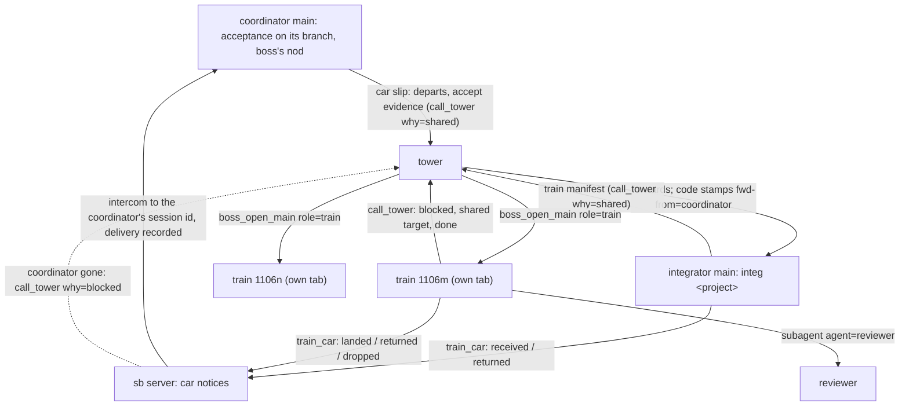
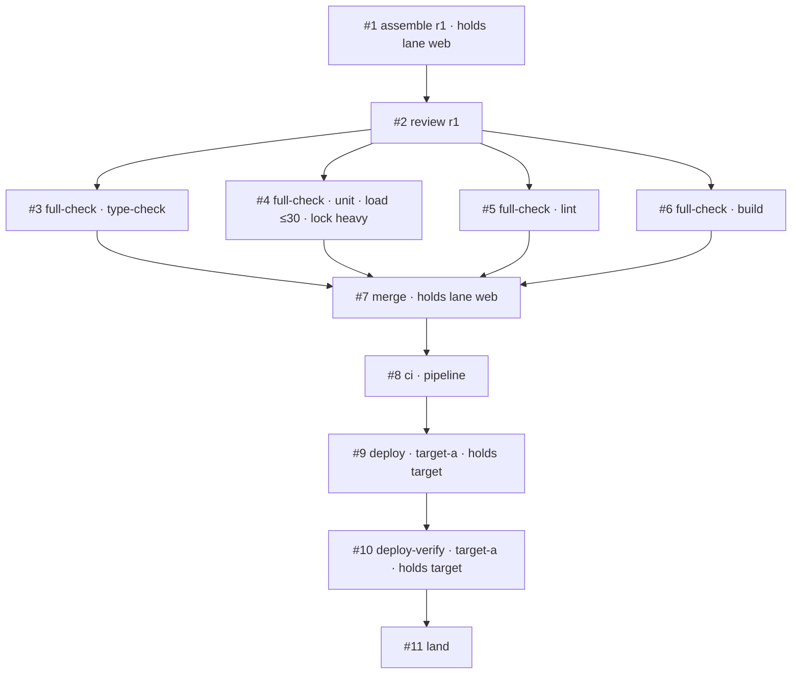

# Trains as their own workers

Status: decided, not built. Todo #125. Base `main` 9b2cbe48 (0.61.0); first committed at 3874ae4b, revised the same day after the boss's correction D11 (a train carries no acceptance). Extends [the merge train](2026-10-30-merge-train.md), [train stages](2026-11-05-train-stages.md) and [seam bindings](2026-11-06-seam-bindings.md). The boss's summary page is `~/.local/share/sbd-review/train-workers/decisions.md`; the task 0 spike is `~/.local/share/sbd-review/train-workers/spike.md`.

## 1. The request and the decisions

The boss (verbatim, 11/07):

- 「我想把火車當成一種新的獨立 worker，這樣可以在 gui 上面也看到塔臺那邊的運送狀況（要求火車要建立 todo，然後用 todo 來顯示現在有幾個火車在互相等待），也能看出重新組裝的時候，如果監看格式統一，甚至可以看他們要求的負載」
- 「這樣我們的 sb net herdr plugin 的排序和 icon 也可以調整一下」
- 「火車的每一節 todo 也可以帶規格（可以用 sb 指令來確保規格，包括監看器的規格），分成 UAT or e2e、Full Test、Review 等等種類（你幫我規劃）」

Decisions (ask_user, the decision form, and the correction, 11/07):

| # | Decision |
|---|---|
| B1 | A train is a worker of its own, a new role `train`, named like `train 1106m`, with its own todos. |
| B2 | Waits show through the todos: what a step waits for is readable from it, and the GUI draws the waits and counts them. |
| B3 | One monitor format: every command a train runs goes through `MonitorCreate` and reports e.g. `{"progress":{"load":{"max":30,"now":42}}}`; the GUI shows 「等負載 ≤30（現在 42）」 and each train's CPU need. `progress.message` is always present (§8.2). |
| D1 | 「獨立 agent，不需要綁定整合員。需要在 sb 記錄上看出他是火車而非一般 main agent」: the tower opens a train in a tab of its own (`boss_open_main` with the role `train`); it calls the tower itself; it does not count toward the tower's two opened mains, and the project's `maxTrains` limits it. Straw Boss's records (Herdr tokens, role records, the net, the registry, the work board) carry the role `train`, distinct from `main` (§3.3). |
| D2 | 「整合員要設，可能我誤會了。我一開始以為成塔台了」: the integrator stays. It takes the cars and schedules trains (which train a car rides, when a new train is asked for). Once a train departs it runs on its own; the integrator does not supervise it. |
| D3 | Train codes are unique per project and shown as `MMDDx` (`2026-11-06-m` is `1106m`). |
| D4 | `maxTrains` defaults to 3 per project. |
| D5 | A named machine-wide lock, now, in the gate wrapper. |
| D6 | The sidebar: the integrator right under the tower, the trains by code; a row keeps its place while its state changes. |
| D7 | 「由 main agent 把貨物搬上車以後，指定出車條件。貨物的驗收條件 type 只是分類，流程中立。」: the coordinator loads its car and states on the slip when it may depart. A step's kind is a classification only: Straw Boss prescribes no flow per kind. (Its acceptance part is replaced by D11.) |
| D8 | 「每個 todo 都必須是一節，因此如果重新打包組裝，需要更新 todo」: every todo of a train is a step, and a re-assembly rewrites the train's todos. |
| D9 | Zen shows counts only. |
| D10 | No switch for the pilot. |
| D11 | The correction: 「我覺得我好像搞錯了，UAT 指的是 e2e（有必要的話），我說的是全檢查，火車不要被 UAT 卡住。事實上 e2e 好像也不宜讓火車做，火車主要是做組裝和 pre push、pre merge、pre ci/cd 前的資源總調度，而非把驗收留到這裡」. Acceptance (e2e, UAT) happens before loading: the coordinator runs it on its own branch with the boss's nod, and every car on a train is already accepted. A train never waits on a person. The earlier decision that a train waiting on acceptance does not count toward `maxTrains` (old D11, Q1) is void with it. |
| D12 | A train ends only after CI/CD has finished and a machine check reads the train's own version on each target. On a failure it rolls back or reports, then ends. It owns the order of its deploy targets. |
| D13 | 「火車如果被要求要做 UAT 或進一步驗收，要拒絕直接退回要求重寫驗收標準」: a car, slip, evidence file, or step that asks the train for UAT, e2e, or any acceptance is refused at once and returned to its coordinator, with words that name what was asked and ask for the acceptance criteria to be rewritten (§5.4). The train never runs it, never waits for it, and never turns it into a weaker check. |

| D14 | The boss's choice on coordinator notices (11/07), after seeing trains forget to tell the main a car came from: **"sb sends the notices itself and confirms delivery."** The train (and the integrator, for a car it returns at receipt) only sets each car's state; the sb server sends the intercom to the car's coordinator session id, records the broker's delivery, and holds the car's step until then; a coordinator that is gone is reported to the tower. The slip's `coordinator` must be the session the tower's code-written header names as the sender (§5.5). |

Straw Boss stays project-neutral: no environment is named here or in a prompt (train stages D3).

## 2. What exists today

- **The integrator does everything.** `prompts/integrator.md` makes one main per project carry every train through `merge`, `deploy`, `uat`, following pi-anchorloop 2.10.1's `integrating` and `deploying`. It keeps "one todo per train" and the ledger `trains/<project>/<app>.json`.
- **UAT waits inside the train.** `deploying`'s UAT stage runs after `Deploy verify`, and a `uat` car "counts as landed only after the page accepts it"; the integrator reports idle only when no UAT page waits. The live ledgers show trains parked for a day on a boss verdict.
- **The ledgers are free text.** The four live ledgers of the pilot project (`trains/<project>/*.json` in the state folder, read only) hold 100 trains. `stage` is prose (`"deployed; boss UAT: all accepted except …"`), keys vary by train (`gates_run1`, `uat_page`, `deploy_verify`, a target's name as a key), and codes come in two forms (`1107g`, `2026-11-07-d`), each counted per app. One ledger names `"integrator": "integ v3 (tower-opened)"`: in practice several integrators ran per project. No reader can tell from a ledger which train waits on which.
- **Roles are two words.** `sb_role` is `main` or `member` on a pane (`tower`, `head`, `ally` are written by the server). The spike (d) found no reader that crashes on an unknown value: each compares a literal, tests a `Set`, or tests truthiness. A value such as `train` is ignored as "not joined" by the net, the dashboard, `awaitJoin`, the member counts, and the closer; the stash refuses a tab that holds it; message headers call it `session`; `isPiPane` treats it as a pi pane. `boss_open_main` (`src/opener.ts`) opens at most `MAX_OPENED_MAINS` = 2 per workspace and one per sender, counted from live panes that carry `sb_opened_by`.
- **The GUI sees a todo list only in short.** A session's bridge sends `TodoSum` (`done`, `total`, `now`; `src/todo.ts`). rpiv-todo 2.15.0 keeps `metadata` in every snapshot (create copies it, update merges keys, `null` deletes one; spike (a)), but `todosOf` (`src/items.ts:16`) rebuilds each task as `{id, subject, status, activeForm}`, so nothing of Straw Boss sees it.
- **Monitors show their last line.** `trackMonitors` (`src/monitors.ts`) keeps the newest output line, cut to 160 characters. pi-loop-monitor 0.2.8 sends at most one `monitor:output` per second, carrying only the latest line. Its JSONL parser takes `progress` only with a numeric `current` or `total` or a string `message`: `{"progress":{"load":{...}}}` alone is no progress to it and does not renew the inactivity timeout (the 11/07 lesson: a redirected 25-minute test run was killed at its timeout).
- **A `tool_call` handler can block a call and rewrite its arguments.** pi hands the same validated arguments object to the `tool_call` handlers and then to `execute`, with no re-validation (spike (b): `agent-loop.js:489-492, 534-538`); pi-loop-monitor's `MonitorCreate` reads `params.command` and `params.timeout` at run time. A rewrite mutates `event.input` in place (the handler's return value carries only `block` and `reason`), keeps the types (`command` a string, `timeout` a number ≥ 0), and keeps `command` and `herdrPaneId` exclusive.
- **Machine-wide admission is not built.** Procs release 2 (slots, `cli.mjs slot run|hold`, `docs/specs/2026-11-04-procs.md` §4) is designed only. Projects wait for load in their own words: one skill's `## Load` waits while the 1-minute load is above twice the core count and runs one heavy gate at a time across projects.
- **Car notices are unconfirmed.** The slip's `coordinator` session id, the tower's code-written header (`from=… id=…`), and the manifest all carry where a car came from, but nothing checks that the coordinator was told: `land` was a `report` check on the train's own ledger, and a car returned at receipt (D13) or dropped at a re-assembly had no check at all. The boss saw trains forget to tell the original main. pi-intercom 0.18.1's client answers a send with `delivered` and `delivery` (`socket_delivered`, or `queued` when the broker holds it; `broker/client.ts:400-417`), which the sb server's own intercom connection can read. The tower forwards a slip with `tower_send` as it came, and only the model names the original sender in the text. Subagent sessions appear on intercom as `subagent-chat-<id>` (todo #49), so a name does not reliably reach a session; a session id does.
- **The sidebar.** The Herdr plugin (`herdr-plugin/`, id `wayne930242.straw-boss`, manifest 0.5.1) installs one view sorted by the `sb_order` token and reads no `sb_role`. Order and marks come from the tokens each session writes (`src/order.ts`): star for a main, person for a member, `[sub] <launcher>` for a subagent.

## 3. Roles



### 3.1 The coordinator (accepts, then loads the car)

- **Acceptance first.** Before the slip, the coordinator runs the acceptance its app requires (`integration.accept`, §5.1) on its own branch, as the project skill's `## Acceptance` says (e2e, UAT, where and how), and gets the boss's nod on the result. A car whose project requires none needs no acceptance.
- **The slip** is today's, with two lines (§5.1): `departs:` (when the car may leave) and `accept:` (the evidence that acceptance passed: what ran, on which head, the result, and the boss's words quoted). It checks the evidence with `cli.mjs train check --accept <file>` before it sends the slip.
- **Notices** about its car (received, returned, dropped, landed) come from the sb server, addressed to its session id, under a code-written header with `kind=car_notice` (§5.5). It answers none of them to the train unless it has a question.
- **After landing** it closes its ticket as today; no acceptance follows the train.

### 3.2 The integrator (schedules)

Unchanged in identity: opened by the tower with `boss_open_main`, one per project, named `integ <project>`, closed after its idle `milestone`; it counts toward the tower's two opened mains as today.

It now does only this:

- Receives cars (`integrating` receive-car) and checks each: the slip's fields as today, that its `coordinator` is the sender the tower's code-written forward names (§5.5), `train check --accept` on the evidence, and that the car's `auth` covers every `strict` target the train would deploy to. A failed check returns the car: the integrator sets it `returned` with the reason (`train_car`), and sb tells the coordinator (§5.5), so a train never meets a missing approval or acceptance.
- Sets each car it takes `received` with the train number and the departure conditions; sb sends that receipt. It writes no notice about a car itself.
- Forms trains: places each car on a forming train by its `departs` line and `integrating`'s train step 1 (`maxCars`, `maxWaitMin`, `Load`, a red pipeline). It puts together only cars whose `auth` covers the same `strict` targets, since a deploy ships every car.
- Departs a train when its conditions hold and the project has fewer than `maxTrains` live trains, by asking the tower: `call_tower` `why: shared` carrying one `train:` manifest (§5.3). Its `train` todo for it completes when the tower answers with the opened train's session id.
- Keeps the project's index in the ledger (§10) and one `train` todo per forming train (§7.4).
- Reports idle when its queue is empty and no train it formed waits to be opened. Running trains do not keep it alive.

It does not watch, relay for, resume, or close a train. A car a train returns comes back as a new slip from its coordinator.

### 3.3 The train

A session of its own role, opened by the tower:

```text
boss_open_main({ role: "train", request: <the manifest verbatim>, sender: <integrator>, label: "train 1106m" })
```

- **Who opens it.** The tower only, on an integrator's manifest. A coordinator never asks for one, and a train never asks for another.
- **Where.** A new tab in the tower's own workspace, as an opened main; the train works in `~/.herdr/worktrees/<repo>/train-<code>`.
- **Quota.** The workspace's two opened mains do not count it, and it does not count toward them; the per-sender limit of one does not apply to the role. The open is refused when the project already has `maxTrains` live trains, counted from live panes with `sb_role=train` whose `sb_train` names the project, so the limit survives a tower restart as the main limit does.
- **What it does** (D11, D12): assemble the cars on the latest base; have a fresh reviewer read the assembly; run the project's full checks (`## Full gates`: full suite, type-check, lint, build); push `pre-dev/<code>` and run `## Merge`; watch the pipelines `## Post-merge` names until each concludes; where the train starts a deploy, run `## Deploy` per target in the order it chooses from that heading; read each target's version with `## Deploy verify`; on a failure, roll back as `## Deploy` says and verify the rollback, or report. Each of these is a step (§6). It tells the coordinators nothing itself: it sets each car `landed` (version, commit), `returned` (§5.4's word), or `dropped` (reason, evidence) with `train_car`, and sb sends the notice and confirms its delivery (D14, §5.5). It calls the tower itself: `blocked`; `shared` naming a target before a deploy it starts; `milestone` when done.
- **Never acceptance** (D13). A car that asks the train for UAT, e2e, or any acceptance is returned with §5.4's word; the train never runs it, waits for it, or weakens it.
- **Never a person.** A train has no step that waits on the boss, a coordinator, or a page. What it would need a person for (approval, acceptance) was checked at receipt; anything that still needs one is a failure it reports as `blocked`, then ends.
- **Done** when every target the train deployed reads the train's version (or its rollback's), every pipeline concluded, and every car is landed, returned, or dropped with its notice delivered or escalated (§5.5). It reports `milestone` with the outcome and waits; the tower closes it with `boss_close_main`, which accepts the `train` role on the same checks as an opened main.
- **Name.** `train <MMDDx>`, set by the open and never renamed (`boss_rename` is refused in the role).
- **Prompt.** Its system prompt is `prompts/train.md`, not `main.md`; it ends with its own `## Seam bindings` block (§13), so the session holds exactly one, as `integrating` requires.
- **Hygiene.** A train registers with the sb server as an owner (`procs-hello` with `role: "train"`), as a worker does, so what its gates leave dies with it.

**How the records say "train" (spike (d)).** Two ways were open: a new `sb_role` value `train`, with the readers taught it, or `sb_role=member` plus a separate `sb_train` token. Decision: **a new value `sb_role=train`**, beside `sb_train=<project>/<code>`, which names the train.

- As a `member` a train would be wrong in the records the boss asked about: the net, the board, and the sidebar would show a member (the person mark), not a train.
- It would also be wrong in behavior. The guard crowns a tab's first member when the tab has a tower and no main, so a train alone in its tab would be promoted to main. The election and quit-time counts would count it as a member, and the closer would ask its tab to close. Each of these would need an "unless `sb_train`" exception, scattered and silent where one is missed.
- A new value fails closed where a reader is not taught it (spike (d): ignored as not joined, never treated as a main; the stash refuses), and a table test over the readers makes every one decide.

| Reader | With `sb_role=train` |
|---|---|
| `net.ts` `joinedRole` | joined: a unit with `role: "train"` and `train: {project, code}`; a ref with role `train`; not in `outside` |
| `dashboard.ts` | a row with the train mark |
| `spawn.ts` `awaitJoin`, `opener.ts` | the open waits for `train` exactly |
| `guard.ts:75`, `server/towers.ts:565`, `session.ts:266` (member counts) | counted as a joined session of the workspace (it needs the tower); never crowned, never a main; `boss_promote` refused in its tab; a later pi in that tab stays a member the train does not command |
| `stash.ts` | refused, naming the reason: "a train runs in this tab" |
| `closer.ts` | skipped: only the tower closes a train (`boss_close_main`) |
| `closemain.ts` | accepts `train` with the same checks as an opened main |
| `roles.ts` | a role record with `role: "train"`, the project and the code; a Herdr restore brings it back as a train with the main's terminal proof |
| `reach.ts` `ROLES`, `agent/sidecar.ts`, `header.ts` | header role `train`; a new kind `car_notice` (§5.5) |
| `order.ts` | `orderKey` takes `train` (§12) |
| board (`boardauto.ts`, `boardread.ts`), `tower_list`, `boss_status` | entries carry `role: "train"`; a train's board line auto-fills from its todos as a main's does |
| `answerpane.ts` `isPiPane`, `runmode.ts` `RUN_PANE_ROLES`, `link/*` | unchanged (a pi pane; not a run pane; never routed as a main) |

### 3.4 Concurrency

- **`maxTrains`** (top-level `integration`, default 3): the project's live trains, from the open to the close. With D11 a train never idles on a person, so there is no state that holds a place without work.
- **Holds.** A step may declare `holds` (§6.1): `lane` (an app's integration branch) or `target`. A train holds a lane or target from the start of the first step that declares it until every step of the round that declares it has completed. A later train's step that declares the same hold waits (§7.3). Which steps declare which hold is the project skill's and `integrating`'s (one train per integration branch from assembly to its merge; one per target from its deploy to its verify), not a rule of any kind.

### 3.5 Re-assembly

A dropped car starts a new round, and the todos say so (D8):

1. The train waits for the running monitors of round `n` to end (or stops them), then completes every step of round `n` that has not passed, and every passed step whose `on.head` is round `n`'s head, as `void` with `why: "superseded"`, naming the dropped car.
2. It creates `assemble` for round `n+1`, whose spec lists the cars kept and `removed`: each dropped car, why, and the evidence (failing tests and log path, or a review finding).
3. It creates round `n+1`'s steps again against the new head.
4. It sets each dropped car `dropped` with the reason and the evidence (`train_car`); sb tells its coordinator (`integrating` train step 5) and confirms the delivery. Round `n+1`'s `assemble` cannot pass until every car in its `removed` is notified (§5.5). The car comes back, reworked and accepted again where its project requires it, as a new slip to the integrator.

A red pipeline after the merge, and a failed target, are not re-assemblies: the train rolls back or reports and ends (D12); a revert or a fix-forward car goes as a new train the integrator forms.

## 4. One train in todos



`blockedBy` orders the steps inside one train (rpiv-todo checks it within one list). The order is the train's, from `integrating`, `deploying` and the project skill; Straw Boss reads only each step's spec and evidence. A failed `deploy-verify` adds a `rollback` step and its own `deploy-verify` of the rolled-back version.

## 5. What the slip and the manifest carry

### 5.1 Two slip lines, one setting

```text
departs: next | alone | with <ticket or branch> | after <ISO time> | by <ISO time>   (several, comma-separated)
accept: <evidence file> | none
```

- `next` (the default) rides the next train of its app. `alone` rides a train of its own. `with` waits for the named car, at most `maxWaitMin`. `after` does not leave before the time; `by` leaves no later than the time, even below `maxCars`, while `Load` and a red pipeline still hold it.
- `accept` replaces the `uat:` line. `none` is allowed only for an app whose `integration.accept` is empty.
- **`integration.accept`** (per app in `apps.json`, default `[]`): the acceptance kinds a car of that app must show evidence of, such as `["e2e"]` or `["e2e", "uat"]`. It replaces `uat` in `stages`, which now lists `merge` and optionally `deploy` (§14).

### 5.2 The evidence file

```json
{ "v": 1, "car": { "app": "web", "tickets": ["T-15"], "branch": "fix/t-15", "head": "<40 hex>" },
  "accepted": [
    { "kind": "e2e", "what": "checkout flow, browser run", "on": { "head": "<40 hex>" }, "result": "passed", "evidence": "<log or report path>", "at": "2026-11-07T07:10:00Z", "nod": "<the boss's words, verbatim>" },
    { "kind": "uat", "what": "order form checkpoints", "on": { "head": "<40 hex>" }, "result": "accepted", "evidence": "<captures folder>", "at": "…", "nod": "<the boss's words, verbatim>" }
  ] }
```

`train check --accept <file> [--app-accept e2e,uat]` refuses (exit 2, one line per refusal) when:

- a kind the app requires has no entry, or an entry's kind is not `e2e`, `uat`, or `other` (with `label`);
- an entry's `result` is not `passed` or `accepted`, its `evidence` path does not exist, its `nod` is empty, or its `at` is not a time;
- an entry's `on.head` is not the car's `head`. The one allowed difference: `on.head` is an ancestor of `head` and the entry names `delta`, a review report of the diff since that head, when the project skill's `## Acceptance` allows it;
- the file is over 32 KB, or `car.head` differs from the slip's `head`.

The check proves the evidence is complete and names the car's head; it does not prove the boss said the quoted words (§16). The integrator runs the same check at receipt.

### 5.3 The manifest

The integrator's `train:` block, which the tower passes verbatim as the open's request: `project`, `app`, `code`, `base`, `stages`, `targets`, `skill`, the integrator's session id, and each car's slip verbatim with its evidence file. The train copies each evidence file into its trainboard folder (`car-<n>.json`) and records it in its ledger file; it does not use it further.

### 5.4 A request for acceptance is refused (D13)

Acceptance is done before loading, so anything that asks the train to accept a car is a slip to rewrite, not work for the train. It is refused wherever it appears, with one refusal word:

```text
sb: the train runs no acceptance: car <ticket> asks for <what> (<where>); rewrite its acceptance criteria and run them before loading, then send the evidence in accept:
```

| Where | What counts as asking | Who refuses | Then |
|---|---|---|---|
| The slip | a `uat:` line; an `accept:` that names a checkpoints or conditions file instead of evidence; free text in any field asking for UAT, e2e, or acceptance on the train or after deploy | `train check --accept` (reads the slip with `--slip`), the integrator at receipt | the integrator sets the car `returned` with the word; sb sends it to the coordinator and confirms delivery (§5.5); it joins no train |
| The evidence file | an entry without `result` or with `result` other than `passed` or `accepted` (`pending`, `todo`); an entry with `check`, `run`, `page`, or `checkpoints` to be done; a top-level `conditions` (the old format) | `train check --accept`, the integrator | as above |
| The manifest | a car that carries any of the above (a check was skipped) | the train, before `assemble` | it leaves that car out of round 1 (it is in the round's `removed`) and sets it `returned` with the word; sb tells the coordinator, and round 1's `assemble` cannot pass until that notice is delivered; the train runs nothing of it |
| A train's todo | a step of kind `e2e`, `uat`, or anything not in §6.2; a check type other than `run`, `git`, `report`, `notice`; a `run` whose `name` or spec says it accepts a car (`accept`, `uat`, `e2e` in `name`) | the guard (§7.1) | the call is blocked with the word; the train completes no such step and opens no page |

The refusal never degrades: the train does not run a weaker check in place of the asked one, does not wait for the acceptance, and does not keep the car waiting on the train. A car returned this way comes back as a new slip once its coordinator has rewritten its criteria and run them.

### 5.5 Car states and notices (D14)

The train and the integrator decide what happened to a car; the sb server tells its coordinator and proves it did. No session writes a notice about a car's fate itself.

**The states.** A car's state is set with the tool `train_car`, registered in a train and in the integrator only:

```text
train_car({ car: "<first ticket>", state: "received" | "landed" | "returned" | "dropped", ... })
```

| State | Set by | Fields | Checked by the tool | The notice says |
|---|---|---|---|---|
| `received` | the integrator | `train` (code), `departs` (the conditions in words) | the car's slip is on the integrator's branch with a matching `fwd-from` (below) | `received: your car <ticket> (<head12>) rides train <MMDDx>; it departs <conditions>` |
| `returned` | the integrator (receipt), the train (manifest, §5.4) | `reason`: §5.4's word or the failed receipt check, verbatim, at most 600 characters | the car is the integrator's (on its branch) or the train's (in its manifest) | `returned: your car <ticket> (<head12>): <reason>` |
| `dropped` | the train | `round`, `reason`, `evidence` (a path that exists) | the car is in the current round and in the next round's `removed` | `dropped from train <MMDDx> round <n>: <reason>; evidence <path>` |
| `landed` | the train | `version`, `commit` (40 hex) | `git merge-base --is-ancestor <commit> <the base's remote branch>` in the train's worktree, after a fetch | `landed in <version>, your commit is <commit>` |

The tool appends the state to `<state>/trainboard/<project>/cars/<app>-<head12>.json` (the car, its coordinator, and every state with who set it and when; folder 700, file 600; one writer, the session's extension, which holds the file's lock for the append). A car has one terminal state (`landed`, `returned`, or `dropped`); a second is refused (`sb: car <ticket> is already <state>`). A dropped or returned car that comes back is a new car with a new head and a new file.

**The coordinator is the sender.** When the tower forwards a car slip, `tower_send` takes `forward: <event id>` (the `call_tower` event the slip came in), and the code stamps `fwd=<event id> fwd-from=<sender session id>` into the header from the event it recorded; the model cannot write those fields, and a forward without them is no car slip. At receipt the integrator's guard requires the slip's `coordinator` to equal `fwd-from` on a forwarded message on its branch that carries the slip's `head`; otherwise the `train` todo and `train_car received` are refused: `sb: car <ticket> names coordinator <id>, but <fwd-from> sent it; the slip is refused`, and the integrator sets the car `returned` with that word, which sb sends to `fwd-from`, the session that really sent it.

**Sending.** `src/server/carnotices.ts` in the sb server watches the `cars/` folders (`fs.watch` and a 5 s tick). For each state without a delivery record it:

1. Resolves the coordinator by session id in the broker's list of live sessions. A name is never used, since subagent sessions appear as `subagent-chat-<id>` (todo #49).
2. Sends one intercom message to that id under a code-written header: `from=<train or integrator name> id=<its session id> role=<train|main> kind=car_notice … reply=none`, then the line from the table. The server is the intercom sender; the header names the session that set the state, so a reply goes to it.
3. Records in `<car file>.notice.json` (the server is its one writer): per state, the message id, each attempt, the broker's answer, and `deliveredAt` when the answer is `delivered: true` with `delivery: "socket_delivered"`.
4. Treats `queued`, a failure, and an unknown outcome as not delivered, and tries again at 30 s, 2 min, and 5 min.
5. When the coordinator is not live at an attempt, or after the last retry, sends `call_tower` `why=blocked` to the workspace's tower, naming the car, the state, the coordinator's id, and the notice text, and records `escalatedAt` once that message is delivered. A coordinator that comes back live later still gets the notice, once.

Every state is sent once: the records are keyed by (car, state), and a server restart resumes from them without a second send.

**What waits for it.** A step that depends on a notice cannot pass until the notice is delivered or escalated:

- `land` is a `notice` check (§6.3) over every car that landed.
- An `assemble` whose spec lists `removed` cars passes only when each one's `dropped` or `returned` notice is delivered or escalated, besides its `git` check.
- The integrator's `train` todo goes `in_progress` (the manifest's `call_tower`) only when every car's `received` notice is delivered or escalated.

Escalated counts, because the tower then owns finding the coordinator's owner; a train is never held for good by a session that ended. The yard shows which notices are delivered, pending, or escalated (§11.2).

## 6. Steps

### 6.1 The step spec

Every todo of a train carries one object under `metadata.sb`; nothing else of a todo is Straw Boss's.

```json
{
  "sb": {
    "v": 1, "project": "acme", "app": "web", "train": "2026-11-06-m", "round": 1,
    "kind": "full-check", "name": "unit",
    "spec": {
      "check": { "type": "run", "cwd": "~/.herdr/worktrees/web/train-2026-11-06-m", "run": "<the gate's command>", "log": "<path>" },
      "on": { "head": "<40 hex>" },
      "load": { "max": 30, "weight": 4 },
      "lock": "heavy",
      "holds": { "lane": "web" }
    },
    "result": { "outcome": "passed", "evidence": "<one line>", "at": "2026-11-07T08:40:00Z" }
  }
}
```

- `kind` is one of §6.2's words; `name` tells apart steps of one kind (several gates, several targets).
- `check` says how the step passes (§6.3); it is the one required part.
- `on` is what the check is against: `{ head }` (a commit) or `{ target, version }` (a deployed result). It is required for every check except `notice`, and it decides what a re-assembly voids (§3.5).
- `load` is `{ max }` (a load average) or `{ perCore }` (resolved against the core count where it runs), with an optional `weight`, the cores the step expects to use (the slot weight of procs release 2). It is the CPU need the GUI shows. Only a `run` check takes it.
- `lock` is a name of the machine-wide lock (§9.1); only a `run` check takes it.
- `holds` declares a lane or a target (§3.4).
- `result` is set only on `completed`: `outcome` is `passed`, `failed`, or `void` (with `why`: `superseded` or `skipped`, a stage the app does not declare). rpiv-todo has no failed state, so a failed step is `completed` with `outcome: "failed"`, and the GUI colors by outcome.
- `project` and `app` are path-safe names (letters, digits, `.`, `_`, `-`; 1 to 64 characters); `train` is `YYYY-MM-DD-<letters>`; `metadata.sb` is at most 8 KB as JSON.

### 6.2 Kinds: a classification

The kind names the step for the GUI, the sidebar, and the counts; it decides nothing about order, check, or holds (D7). The set is closed, so a reader can name every step, and it holds only what a train does (D11): no `e2e`, no `uat`.

| Kind | 中文 | Usually | Typical check (guidance only) |
|---|---|---|---|
| `assemble` | 組裝 | `## Train assembly` | `git` |
| `review` | 審查 | the fresh reviewer of the assembly | `report` |
| `full-check` | 全檢查 | `## Full gates`, one step per gate (full suite, type-check, lint, build, …) | `run` |
| `merge` | 合併 | `## Merge` (push of `pre-dev/<code>` and the merge) | `run` |
| `ci` | CI/CD | `## Post-merge`: each pipeline until it concludes | `run` with `expect` |
| `deploy` | 部署 | `## Deploy`, one per target | `run` |
| `deploy-verify` | 部署驗證 | `## Deploy verify`, one per target | `run` with `expect` |
| `rollback` | 回滾 | `## Deploy`'s rollback, one per failed target | `run` |
| `land` | 落地 | every car's `landed` notice delivered by sb (§5.5) | `notice` |

A test scans the prompts and the code for exactly this set.

### 6.3 Checks: how a step passes

The check type is what Straw Boss enforces, whatever the kind. Each is read by a machine; no check waits on a person (D11).

| Type | Spec | Runs through | Passes when (the guard checks it) |
|---|---|---|---|
| `run` | `cwd`, `run`, `log`; optional `verify` (a command after `run`), `expect` (the last stdout line of `verify` must equal it), `poll` (`everySec`, `forMin`, for `expect`) | `MonitorCreate`, rewritten to the wrapper (§8) | the wrapper's outcome for this frozen spec is `passed` |
| `git` | `cwd`, `contains` (commits that must be ancestors), optional `ref` | the guard itself | `git -C cwd` shows `result.head` as `HEAD` (or `ref`), every `contains` commit is its ancestor, and `on.head` equals `result.head` |
| `notice` | `cars` (tickets), `state` (`landed`, `returned`, or `dropped`) | the sb server (§5.5); the session only sets the state with `train_car` | every named car's terminal state is `state` and its notice record has `deliveredAt` or `escalatedAt` |
| `report` | `path`, `expect` (the verdict, such as `P0=0 P1=0`) | a subagent or the session | the file exists, is not empty, changed after the step went `in_progress`, and `result.verdict` equals `expect` |

`ci` and `deploy-verify` are `run` checks with `expect`: the project's command prints the pipeline's conclusion or the version the target runs as its last line, and the wrapper polls it. "A finished monitor is not done" is then enforced, not only said. A step whose check failed completes `failed`; the train follows `integrating`'s red handling before the merge, and `deploying`'s rollback after it.

## 7. The guard: sb checks a spec before a step starts

`src/trainguard.ts`, a `tool_call` handler in the Straw Boss extension. In a session with the role `train` it handles every `todo` and `MonitorCreate` call; in the integrator, only `todo` calls that carry `metadata.sb`. Following spike (a), policy checks read the call's `event.input` (`action`, `metadata`, each `tasks[].metadata` of a batch create), and state checks read the todo list from the session's branch (`ctx.sessionManager.getBranch()`, the walk of `todosOfBranch`, with metadata) with the call applied to a copy, since an update merges metadata (`null` deletes a key) and only the merged snapshot shows the result. A refusal blocks the call (`{ block: true, reason }`); the list does not change, and the model reads the reason.

### 7.1 `todo` calls

| Check | Refusal |
|---|---|
| A step asks for acceptance (§5.4): kind `e2e`, `uat`, or another acceptance word, or `name` containing `accept`, `uat`, or `e2e` | `sb: the train runs no acceptance: car <ticket> asks for <what> (<where>); rewrite its acceptance criteria and run them before loading, then send the evidence in accept:` |
| A train's todo carries `metadata.sb` (D8) | `sb: every todo of a train is a step: add metadata.sb (kinds: assemble, review, full-check, merge, ci, deploy, deploy-verify, rollback, land)` |
| `kind` is in the set | `sb: kind "<x>" is not a step kind (…)` |
| The common fields hold (§6.1) | `sb: metadata.sb.<field> <what is wrong>` |
| The check type is `run`, `git`, `report`, or `notice`, and its fields are present and well formed (§6.3) | `sb: a <type> check needs <field>`, `sb: check type "<x>" is not one a train runs (run, git, report, notice)` |
| `train`, `project`, `app` are this train's, and `round` its current round | `sb: step #<id> names train <x>, round <n>; this train is <y>, round <m>` |
| A new round's `assemble` comes after every step of the old round has completed | `sb: round <n> still has step #<id> <status>; complete it (void) first` |
| `completed` carries `result`, and `passed` meets the check (§6.3) | `sb: step #<id> passes only when <criterion>; <what is missing>` |
| A `run` step completes `passed` only after its monitor ended `passed` for this spec | `sb: step #<id> has no passed run of its spec (last: <state>)` |
| A step that depends on a notice passes only after it is delivered or escalated (§5.5) | `sb: step #<id> waits for sb to tell <coordinator> that car <ticket> is <state> (<attempts>, last: <answer>)` |
| `metadata.sb` within 8 KB | `sb: metadata.sb is <n> KB, more than 8` |

### 7.2 `MonitorCreate` calls

A train's monitor runs exactly one `run` step. The model calls `MonitorCreate` with `description: "train <code> #<step id> <kind>"` and `command` set to the step's `check.run` verbatim. The guard then:

1. Checks that step `#<id>` exists, is this train's, is `in_progress`, has a spec that passes §7.1 and a `run` check, that `command` equals `check.run`, that `herdrPaneId` is absent, and that no monitor of the step runs. Refusals: `sb: a train's monitor runs one step: describe it "train <code> #<id> <kind>"`, `sb: step #<id> runs "<check.run>", not this command`, `sb: step #<id> is <status>; a monitor starts only for an in_progress step`, `sb: step #<id> already has a running monitor (#<monitor>)`.
2. Freezes the spec into `<state>/trainboard/<project>/<code>/step-<id>.json` (mode 600).
3. Mutates `event.input` in place (spike (b)): `command` becomes the wrapper, `'<node>' '<cli.mjs>' train gate --spec '<that file>'`, and `timeout` becomes a number of at least 120000 ms (the wrapper prints a line every 30 s, so the inactivity timeout never ends a long gate). `description` stays, so the bridge's monitor list and the trainboard join on it.

This is the monitor spec the boss asked sb to enforce: the description names the step, the command is the step's, and the lines follow §8.2 because the wrapper writes them. A gate cannot run outside it in a train. Heavy commands run through plain `bash` are not caught; procs release 2's heavy-command hook is where that belongs (§16).

### 7.3 Waits

Straw Boss derives every wait from the spec; the model writes none. Every wait is on a machine or another train (D11).

| Wait | From | Resolved when | Who checks | The GUI says |
|---|---|---|---|---|
| load | `load` | the 1-minute load average is at most the limit | the wrapper, every 30 s | 等負載 ≤30（現在 42） |
| lock | `lock` | the named lock is free | the wrapper | 等鎖 heavy（train 1107d 持有） |
| lane | `holds.lane` | no earlier train holds the lane | the wrapper, or the guard at `in_progress` for a step without a monitor | 等 1106l 合併道（web） |
| target | `holds.target` | no earlier train holds the target | as lane | 等 1106l 部署目標（target-a） |

"Earlier" is by departure order (the code), so two trains never wait on each other in a cycle. Holding is computed from the trainboards by one pure function (`holders`, §11.1). A trainboard that cannot be read, and the board of a train whose session is gone without ending (§10), hold what they held: the wait says why, and only `train clear` (§9.2) releases it. 「互相等待」 in the GUI is the count of trains with a lane or target wait held by another train.

### 7.4 The integrator's `train` todo

```json
{ "sb": { "v": 1, "project": "acme", "app": "web", "train": "2026-11-06-m", "kind": "train",
  "spec": { "cars": [{ "tickets": ["T-12"], "branch": "fix/t-12", "head": "<40 hex>", "coordinator": "<session id>", "departs": "next", "accept": "<path>", "arrived": "…" }],
            "departs": { "maxCars": 4, "maxWaitMin": 60, "oldest": "…" } } } }
```

`pending` while the train forms, `in_progress` from the manifest's `call_tower` (refused until every car's `received` notice is delivered or escalated, and each car's `coordinator` matches its `fwd-from`, §5.5), `completed` when the tower answers (`result.outcome` `passed` with the train's session id, or `failed` with the refusal). The guard checks its fields and runs `train check --accept` on each car's evidence.

## 8. The wrapper and the monitor format

### 8.1 `cli.mjs train gate --spec <file>`

The process `MonitorCreate` runs. It reads the frozen spec (refusing, exit 3, one that does not validate), then:

1. **Waits** while a load, lock, lane, or target wait of the step is unresolved, rechecking every 30 s and printing a `waiting` line each time.
2. **Runs** `run` in `cwd` through the shell as a child in a process group of its own, with stdout and stderr appended to `log`. It holds a lock in this parent process for the child's life (not `exec`: the lesson of a lock dropped across `exec`). It prints a `running` line every 30 s with the elapsed time, the load now, and the log's last line cleaned and cut to 200 characters.
3. **Verifies**: after `run` exits 0 it runs `verify` when the spec has one, and compares its last stdout line with `expect`, polling as `poll` says.
4. **Ends** with one outcome line and an exit code: 0 `passed`, 1 `failed`, 3 `refused`, 143 `stopped` (SIGTERM: it sends SIGTERM to the child's group, SIGKILL after 10 s, releases the lock, and says so).

Beside its stdout it writes `<state>/trainboard/<project>/<code>/gate-<id>.json` on every line: state, since, load now, the holder it waits on, pid and start time. The server reads that file (§11.1), so the GUI does not depend on which stdout line pi-loop-monitor happened to pass on.

### 8.2 The line format

One JSON object per line, at most 1000 characters, and nothing else on stdout:

```json
{"progress":{"message":"waiting: load <=30 (now 42)","load":{"max":30,"now":42}},"sb":{"v":1,"train":"2026-11-06-m","step":4,"kind":"full-check","state":"waiting","waits":[{"load":{"max":30,"now":42}}],"since":"2026-11-07T08:00:00Z"}}
{"progress":{"message":"running 12m: unit (load 18)","load":{"max":30,"now":18}},"sb":{"v":1,"train":"2026-11-06-m","step":4,"kind":"full-check","state":"running","since":"2026-11-07T08:12:00Z","tail":"✓ 1204 tests"}}
{"monitorOutcome":{"status":"passed","message":"exit 0 in 18m3s"},"sb":{"v":1,"train":"2026-11-06-m","step":4,"kind":"full-check","state":"passed","exit":0}}
```

- `progress.message` is always present, so pi-loop-monitor counts every line as progress and renews the inactivity timeout; `progress.load` is the boss's shape. `message` is English for the model; the GUI words the wait itself from the fields (§11.2).
- `sb.state` is `waiting`, `running`, `verifying`, `passed`, `failed`, `refused`, or `stopped`; `monitorOutcome.status` is the same word, so `onSignal` and `onDone` see the end.
- Every line carries the whole state, so the latest line alone is enough wherever only the latest line arrives.
- `src/monitors.ts` learns the format for every monitor, not only trains': a line that parses as `{progress: {message}}` shows its `message` as the monitor's last line instead of raw JSON, and `progress.load` is kept as `load` on the `Monitor` (checked by `monitorsOk`).

## 9. The lock and the other `train` commands

### 9.1 The lock (D5)

The wrapper takes a named lock under `<slot dir>/locks/<name>.lock`, holding an open descriptor with `flock` in its own process for the child's life, with its holder (train, step, pid, start time) beside it in `<name>.json`. Names are `[a-z0-9-]{1,32}`. A holder whose pid is gone or reused loses the lock at the next look. Procs release 2's slots take over the same names later.

### 9.2 Commands

| Command | Effect |
|---|---|
| `train check (--step <spec.json> \| --accept <file> [--app-accept K,…] [--slip <file>])` | Validates one step's `metadata.sb`, or a car's acceptance evidence (§5.2) and, with `--slip`, the slip itself for a request for acceptance (§5.4), with the guard's validator; prints the refusals, exit 2 when any. The coordinator runs it before it sends a slip, the integrator at receipt. |
| `train status [--project P] [--json]` | Every train on this computer from the trainboards: project, app, code, session (live or gone), round, steps with state, the waits with their holders, the load each needs, the locks held, and each car's state with its notice (delivered, pending with its attempts, or escalated). `/boss trains` shows the same in a session. |
| `train notices [--project P] [--pending] [--json]` | Every car's states and notice records from `cars/`: who set each state, the text sent, the attempts, `deliveredAt` or `escalatedAt`. |
| `train clear --train <code> --project P (--lane <app> \| --target <name>) --reason TEXT` | Releases what a train whose session is gone still holds, writing who cleared it and why into its trainboard. Refused while the train's session is live. Run only after reading the target's version with the project's `Deploy verify`; when it cannot be read, the asker calls the tower `blocked` instead. |

## 10. Trainboards and the ledger

Two kinds of file, one writer each:

- **The ledger** stays the model's (the Record seam): `trains/<project>/<app>.json` keeps the queue and an `index` (code, train session, file, state), written by the integrator; `trains/<project>/<app>/<code>.json` holds one train (cars with their acceptance evidence, SHAs, review, gates, pipelines, versions per target, rollbacks), written by the train. One writer per file ends the race between several sessions on one JSON file. Old entries stay where they are.
- **The trainboard** is Straw Boss's derived state, as the work board is: `<state>/trainboard/<project>/<code>/board.json` is written by the train's extension from its todo list after every `todo` call and turn end (atomic rename, folder 700, file 600); `<state>/trainboard/<project>/yard.json` by the integrator's from its `train` todos. Each holds `v`, `project`, `app`, `code`, the writer (session id, pane, pid, start time), `updated`, `round`, `cars`, and each step's id, kind, name, status, round, holds, derived waits, and outcome. The copied evidence files, the frozen `step-<id>.json`, and the wrapper's `gate-<id>.json` sit beside it. The car files and their notice records are in `<state>/trainboard/<project>/cars/` (§5.5).

A trainboard outlives its session on purpose: a train that crashed while it held a target stays visible and keeps its hold. It is `ended` when its `land` step completed, and `stale` when its writer is gone and it was not updated for 10 minutes. The server deletes an ended trainboard 7 days after its last update; a stale one only after `train clear` and the same 7 days.

## 11. The GUI

### 11.1 Data

- `src/server/trainyard.ts` reads `<state>/trainboard/*/` on the net's read (at most 64 trains, 64 KB per file, the writer's validator; a file that fails is shown as unreadable, never guessed), computes `holders` and each train's waits, and adds `yards` to the snapshot: per project the forming trains and their cars (from `yard.json`), and every train with the unit key of its session, so the page can open its comms.
- The bridge's todo summary keeps the step: `todosOf` (`src/items.ts`) and `Todo` widen to carry `metadata.sb` (bounded: known keys only, strings cut to their caps, the 8 KB limit), and `todoOk` (`src/todo.ts`) checks the widened shape on the hub side (spike (a)). The trainboard writer reads the branch directly and does not depend on this path.
- `net.load`: the server's 1-minute load average and core count, for the header chip.
- A train is a unit with `role: "train"` and `train: { project, code }` in its tab.
- `yards` stay on this computer: they are not part of the `board` message, a remote turn, or the operate slice of [link-operate](2026-11-07-link-operate.md). A train's work-board entry goes to allies as a main's does (its name and done count).

### 11.2 What the page shows

- **The yard** (調車場), one per project, opened from a chip on the base header (「火車 3（等待 2）」) and from the integrator's card, so it stays reachable after the integrator closed: the forming trains with their cars, each car's acceptance as a chip (「已驗收：e2e、UAT」, the boss's nod in its tooltip) and its departure condition (「滿 4 節或 60 分（還 23 分）」, 「T-15：單獨出車」); then one row per train: code, app, the cars' tickets, the round (「第 2 次組裝：移除 T-12（unit 紅）」), its steps as pills by kind (組裝、審查、全檢查、合併、CI/CD、部署、部署驗證、回滾、落地) colored by state and outcome, the wait in words (§7.3), the load it needs (「需負載 ≤30，約 4 核」), and each car's notice (「已通知 T-12：已落地」, 「通知中 T-15：退回（重試 2）」, 「已上報塔臺：T-9 的協調者已離線」). The header: 「3 列火車：1 運行、2 等待（互相等待 1）」 and 「負載 42／14 核」.
- **A train's unit card** uses the locomotive icon; its note line is the current step and its wait. Its tab shows on the map as any tab.
- **Zen**: the strip adds the train count and the waiting count only (D9).
- **Language**: zh-TW first, English; the kind words, wait words and counts are paraglide messages.
- **Icon**: game-icons.net "Steam Locomotive" (Delapouite, CC BY 3.0) for a train, added to `gui/ICONS.md` and the sprite; check the file exists before task 7 starts.

## 12. Herdr: tokens, order, and the plugin

The plugin sorts by `sb_order` and changes no code; order and marks come from the tokens (`src/order.ts`), so the work is there plus the documented `config.toml` snippet.

| Row | `sb_order` | `sb_mark` | `sb_name` | `sb_step` (new) |
|---|---|---|---|---|
| Tower | `WWW.0` | none | none | none |
| Tower's subagents, ally runs | `WWW.0.NNN` | as today | as today | none |
| Integrator | `WWW.05.0.PPP` (its tab moved up; its members `WWW.05.1.PPP`) | code-fork, U+F126 | none | none |
| Train | `WWW.06.YYMMDDLL`, `LL` the code's letters left-padded with `0` (`261106` + `0m`) | train, U+F238, and the short code (`\uF238 1106m`) | none | state glyph and kind, at most 24 characters |
| Its reviewer | one segment more, as any subagent | `[sub] train 1106m` | `reviewer` | none |
| Other tabs | `WWW.1.TTT.R.PPP` | as today | as today | none |

- `.` sorts before digits, so the tower's own subagents come before the integrator, and `WWW.05`, `WWW.06` both come before the tabs (`WWW.1…`). A code key does not move when another train ends, so a row keeps its place (D6) and `focus_agent` numbers move only when a row comes or goes.
- `sb_step` glyphs: hourglass U+F254 waiting, play U+F04B running, check U+F00C passed, times U+F00D failed, undo U+F0E2 rolling back. The train writes it on its own pane when its current step changes (debounced 5 s), besides its 4-minute refresh.
- The integrator is known by the `train` todos on its list (`yard.json` names its session); a train by its `sb_role`.
- The documented row snippet gains `{ token = "$sb_step" }` after `$sb_name`, and rules for `\uF126` and `\uF238` (bold). The plugin's manifest version moves only if its files change.

## 13. Prompts and skills

### 13.1 Straw Boss prompts

| File | Change |
|---|---|
| `prompts/integrator.md` | The scheduler of §3.2: receipt with `train check --accept --slip` and the `strict`-target check, a car that asks for acceptance returned with §5.4's word, placing cars by `departs` and by the `strict` targets their `auth` covers, departure under `maxTrains`, the `train:` manifest through `call_tower` `why: shared`, the `train` todo with `metadata.sb`, the idle condition; no supervision of a running train; no UAT page; every car's fate set with `train_car` (`received`, `returned`), never a notice sent by itself (D14). Budget 340 to about 380 words. |
| `prompts/train.md` (new) | The train: one train; its tab; assembly and the checks before push, merge, and CI/CD; every todo a step with `metadata.sb` (§6); kinds classify and the order comes from `integrating`, `deploying` and the project skill; a `run` step through `MonitorCreate` described `train <code> #<id> <kind>`; rounds and void steps on re-assembly; deploy targets in its own order, each read back by machine; rollback or report on failure, then end; never wait on a person; each car's fate set with `train_car` (`landed`, `returned`, `dropped`), never a notice to a coordinator sent by itself, and `land` passes only when sb has delivered them (D14); `call_tower` for `blocked`, `shared` naming a target, and `milestone` when done; the name never changes. It ends with its own `## Seam bindings` block, seven lines (§13.2). Its system prompt; budget about 450 words. Inside the integration markers as a whole: with the switch off the role is refused at the open. |
| `prompts/main.md` | Seam bindings: Batch owner reads "the project's one integrator main schedules trains; each departed train runs in a `train` session the tower opens"; Record names the index and the per-train files; Handoff route adds that the sb server sends every car notice (received, returned, dropped, landed) to the slip's `coordinator` by session id, and that the slip's `coordinator` is the session that sent it; Approval says the boss's nod on acceptance is quoted in `accept`. Still six lines. Budget on 700 to about 720. |
| `prompts/planning.md` | A coordinator runs its app's `integration.accept` before the slip, on its branch, as the project skill's `## Acceptance` says, gets the boss's nod, and writes the evidence file it checks with `train check --accept`; a `human` anchor is this acceptance, not the train's. Budget unchanged (trim elsewhere). |
| `prompts/apps-config.md` | `integration.maxTrains` (top level, default 3); per app `integration.accept`; `stages` is `merge`, then optionally `deploy` (`uat` is gone). |
| `prompts/tower.md`, `tower-run.md` | A `shared` request from the integrator with a `train:` block is no go: open the train with `boss_open_main` role `train`, the manifest verbatim, once per code; a train is no main and does not count toward the two; its `shared` naming a target is checked for a clash like the integrator's deploy; close it after its done `milestone`. A car slip is forwarded with `tower_send` `forward: <event id>` so the code stamps its sender (§5.5). A `blocked` from the sb server about a car notice names a coordinator that is gone: find its owner on the board or record a wait for the boss, as for any `blocked`. |

### 13.2 pi-anchorloop (`wayne930242/anchorloop`), for 2.11.0

The acceptance leaves the train, and the train runs its checks through a seam:

- `integrating` Principle: "Where `stages` include `uat`, a `human` anchor is the train's UAT" becomes "a car's acceptance (`accept` in Settings, such as e2e or UAT) runs before handoff, by its author on its own branch with the approver's nod, and the slip carries the evidence; the train accepts nothing". The Project skill contract: `## UAT` becomes `## Acceptance`, read by the coordinator only (which kinds, where and how, whether a delta since the accepted head is allowed).
- `integrating` Stages: `merge`, then optionally `deploy`; the `uat` stage is removed. After the train: a car is landed when it has no stage left; "accepted in UAT" and "no UAT page waits" go.
- `deploying`: the UAT stage section is removed (the `human-feedback` uat playbook stays for the coordinator's own use); deploy step 2's "ask the approver whether to deploy it or hold the cars" moves to receipt (`receive-car` checks that `auth` covers every `strict` target the train will deploy to, and the owner groups cars by the targets their `auth` covers), so a train never asks; each command of deploy, verify, and rollback through the Step runner; the owner of a train orders its targets per `Deploy`.
- `references/seams.md`: a seventh seam, **Step runner**: how a train's steps are recorded and how a step that runs a command starts, waits for load, locks and holds, and reports its state and outcome. Default: the owner's one todo per train, each heavy check in the session's own shell after `Load`'s wait. Batch owner: "may schedule trains and give each departed train to a session of its own, which then owns it to the end". Record: "one file per app, or an index per app and one file per train". Settings keys: `stages` without `uat`, a new `accept`.
- `integrating/playbooks/receive-car.md`: the slip's `departs` and `accept` lines (§5.1), replacing `uat`; the owner checks the evidence and the `strict` targets.
- `integrating/playbooks/train.md` step 1 departs by the cars' `departs` lines too; steps 2 to 4: one train per integration branch holds it from assembly to its merge; each gate through the Step runner; step 4's pipeline read becomes the train's last pre-deploy step; step 6: a re-assembly voids the old head's steps and recreates them; a red pipeline after the push ends the train with a report, and the revert or fix-forward goes as a new train.

- `integrating`'s Handoff route default and After the train: the owner may hand each car's outcome to the host as a state, and the host then sends the notice and reports its delivery; the owner's step waits for that report. Straw Boss binds it so (D14).

Straw Boss binds the Step runner in `train.md`: "every step is a todo with `metadata.sb` (this prompt); a step that runs a command runs as `MonitorCreate` described `train <code> #<id> <kind>` with `command` its `check.run`, which Straw Boss wraps, and whose lines report `{progress: {message, load}}` and the outcome". Straw Boss then requires pi-anchorloop 2.11.0 or newer (README, the `blocked` lines of `integrator.md` and `train.md`).

## 14. Migration

1. pi-anchorloop 2.11.0 is released first; this Straw Boss release requires it.
2. A project moves `uat` out of `stages` into `integration.accept` (and renames its skill's `## UAT` to `## Acceptance`, read by its coordinators) before it pins this release. An app whose `stages` still lists `uat` is a config error: the integrator does not depart and calls the tower `blocked`, naming the field and the fix, as for a missing heading.
3. A running integrator picks up the new prompts at its next `/reload` or restart. A train already in its ledger with no trainboard is a legacy train: the integrator finishes it itself, the old way, its open UAT pages included, and tells coordinators by intercom as before (no car files, no sb notices); every departure after that opens a train session, and every car received after the release is notified by sb.
4. A slip without `departs` departs `next`; one with `uat:` and no `accept:` is returned with the new format named.
5. The live ledgers are not rewritten. New trains add `index` entries and per-train files; old `trains` entries stay as history.
6. One integrator per project: where several ran per app, the tower's rule already holds for new openings; the extra ones go idle and are closed as usual.
7. A project skill reads better when `## Load` gives a number or a per-core factor, `## Full gates` lists its gates one by one (each becomes a `full-check` step), and `## Post-merge` and `## Deploy verify` give commands whose last line is the pipeline's conclusion or the target's version (the `expect` of a `run` check). That is the project's change.
8. With the merge train off nothing of this loads: no role, no guard, no trainboard, no `yards`; a `boss_open_main` with role `train` is refused with "integration is off on this computer".

## 15. Tasks

Every task is red first; its anchor is `npm run check && npm test` plus its files through `npm run test:one`. GUI key tests also run with a Linux `navigator.platform`, and a post-merge check includes `tests/imports.test.ts`.

Task 0, the spike, is done (`spike.md`): (a) rpiv-todo keeps `metadata` and a `tool_call` handler can read and block `todo` input, but `todosOf` drops it; (b) a `MonitorCreate` rewrite works by mutating `event.input`; (c) a form answer waiting for hours is no longer needed (D11); (d) no reader crashes on a new `sb_role`, and the readers are listed (§3.3).

| # | Task | Files | Red tests | Depends on | Fresh review |
|---|---|---|---|---|---|
| 1 | The contract, pure: kinds, check types, `metadata.sb` and acceptance-evidence schemas, slip lines `departs` and `accept`, `integration.accept`, the validator and its refusal words, holds and `holders`, wait derivation, the trainboard format (read, write, caps) | new `src/train/spec.ts`, `src/train/accept.ts`, `src/train/waits.ts`, `src/train/board.ts` | `tests/train-spec.test.ts` (each check type's fields; `answer`, `e2e`, `uat` refused as a train's; a kind decides nothing: one check passes the same under every kind; a metadata patch with `null`; a batch create), `tests/train-refuse-acceptance.test.ts` (D13: a `uat:` slip line, an `accept:` naming a checkpoints file, free text asking for UAT after deploy, an evidence entry with `result: pending` or a `check` to run, the old `conditions` format, each refused with §5.4's word naming the item; nothing in the refusal path produces a step or a wait), `tests/train-accept.test.ts` (a required kind missing, an empty `nod`, `on.head` not the car's, an ancestor with and without `delta`, a path that does not exist, `none` for an app that requires acceptance), `tests/train-waits.test.ts` (holds from first declaring step to last, earlier-only order so no cycle, an unreadable or stale board holds, `clear` releases), `tests/train-board.test.ts` | 0 | Yes (shared contract) |
| 2 | The wrapper, the lock and the CLI: `train gate\|check\|status\|clear`, the line format, the gate file, SIGTERM | new `src/server/traingate.ts`, `src/server/trainlock.ts`, `src/server/cli.ts` | `tests/train-gate.test.ts` on a fake clock and load source: waits then runs, a line every 30 s and each with `progress.message`, `verify` and `expect` with `poll` (a pipeline that concludes `failed` fails the step), exit codes, a lock held across the child and released on SIGTERM, a dead holder loses the lock, a child group killed, no line over 1000 characters; real children only inside the test root | 1 | Yes (processes, locks) |
| 3 | The role `train` in Straw Boss's records: `boss_open_main` with `role: "train"` (its own count per project against `maxTrains`, not the two, no per-sender limit, once per code), `sb_role=train` and `sb_train`, every reader of §3.3's table, role records and restore, `boss_close_main` for a train, hygiene's hello | `src/opener.ts`, `src/bossopen.ts`, `src/net.ts`, `src/dashboard.ts`, `src/spawn.ts`, `src/guard.ts`, `src/server/towers.ts`, `src/session.ts`, `src/stash.ts`, `src/closer.ts`, `src/closemain.ts`, `src/roles.ts`, `src/reach.ts`, `src/agent/sidecar.ts`, `src/board*.ts`, `src/hygiene.ts`, `src/server/procs.ts` | `tests/train-role.test.ts`: one table over the readers of §3.3, each with `sb_role=train` (fails while any reader is untaught); `tests/train-open.test.ts` (opens beside two opened mains; two trains from one integrator; the fourth live train of a project refused; the same code twice refused; off refused); `tests/train-tab.test.ts` (no crowning, promote refused, a later pi stays a member, stash refused with the reason); restore cases in the roles tests; close accepted for a train and refused for a busy one | 1 | Yes (roles, closing rights) |
| 4 | The train's session: `train.md` as its system prompt, the guard (`todo`, `MonitorCreate` rewrite, completion evidence for each check type), the trainboard writer, `sb_step`; the integrator's `train` todo check; `todosOf`, `Todo` and `todoOk` widened for `metadata.sb` | new `src/trainguard.ts`, `src/trainboard.ts`; `src/session.ts` (prompt choice), `src/items.ts`, `src/todo.ts` | `tests/train-guard.test.ts` (every refusal of §7; a todo of kind `uat` or `e2e`, or a `run` named `accept`, blocked with §5.4's word; a manifest car that asks for acceptance left out of round 1 with the word and no step created for it; the rewrite mutates `event.input` and keeps `description`; a `herdrPaneId` call refused; a `run` pass refused without a passed run; a `git` pass read from a real repository in the test root; a `report` pass refused for a file older than the step; a re-assembly that leaves a step open refused), `tests/todo.test.ts` (metadata kept within its caps, an oversized or unknown-keyed one cut, `todoOk` on the wide shape), `tests/trainswitch.test.ts` additions | 1, 2, 3 | Yes (enforcement) |
| 5 | Server and net: the trainyard reader, `yards` and `load` in the snapshot, monitor progress for every monitor | new `src/server/trainyard.ts`; `src/net.ts`, `src/monitors.ts`, `src/dialogs.ts` | `tests/server-trainyard.test.ts` (server world: two projects, forming and running trains, a stale board, a hostile file refused, the train's unit key joined, acceptance chips from the evidence), `tests/monitors.test.ts` (a JSON progress line shows its message and keeps `load`) | 1, 4's board | With 4 |
| 6 | Herdr tokens and the snippet: the integrator's key and mark, the train keys and marks, `sb_step` | `src/order.ts`, `src/herdr.ts`, `docs/how-it-works.md` Sidebar net view | `tests/order.test.ts` (tower subagents, then the integrator, then trains by code, then tabs; a train ending moves no other row; a reviewer under its train; two-letter codes after one-letter ones) | 3 | No |
| 7 | The page: the yard, the base chip, the train icon and card, Zen's count, strings, demo states | `gui/trains.ts` (pure model), `gui/yard.ts`, `gui/ICONS.md`, `index.html` sprite, messages | `tests/gui-trains.test.ts` (counts, 互相等待, wait words, round text with the removed car, acceptance chips, load need); `visual-tester` for Standard, Geek, Zen and the phone width | 5 | No (anchor + visual check) |
| P | pi-anchorloop 2.11.0 (§13.2): acceptance before handoff and `## Acceptance`, `stages` without `uat`, the UAT stage out of `deploying`, `strict` targets checked at receipt, the Step runner seam, Batch owner, Record and Settings wording, the slip's `departs` and `accept`, lanes and targets as holds, re-assembly voiding | anchorloop `skills/integrating/` (`SKILL.md`, `references/seams.md`, `playbooks/receive-car.md`, `playbooks/train.md`), `skills/deploying/` (`SKILL.md`, `playbooks/deploy.md`) | that repository's own tests | none | Yes (shared contract) |
| 5a | Car states and notices (D14): `train_car` in a train and the integrator, the car files, the server's sender and retries, the `notice` check, `tower_send` `forward` stamping `fwd`/`fwd-from`, the coordinator match at receipt, the `car_notice` header kind | new `src/train/cars.ts`, `src/traincar.ts` (the tool), `src/server/carnotices.ts`; `src/server/runtools.ts` (`forward`), `src/header.ts`, `src/trainguard.ts` | `tests/train-car.test.ts` (each state's fields; a `landed` commit not on the base's remote branch refused; a car not in the manifest or not on the integrator's branch refused; a second terminal state refused), `tests/server-car-notices.test.ts` (server world with a fake intercom client: one send per (car, state) addressed by session id, a `subagent-chat-<id>` name never used; `socket_delivered` records `deliveredAt`; `queued` and a failure retried at 30 s, 2 min, 5 min on the fake clock; a coordinator not live sends one `blocked` to the tower naming the car and records `escalatedAt`; a coordinator back live gets it once; a server restart resumes without a second send), `tests/train-coordinator.test.ts` (a forward without `forward` has no `fwd-from`; the model cannot write `fwd-from`; a slip whose `coordinator` differs from `fwd-from` is refused and returned to `fwd-from`), guard cases in `tests/train-guard.test.ts` (`land` refused before every landed notice is delivered or escalated; a round-2 `assemble` refused before its `removed` cars are notified; round-1 `assemble` refused before a car returned from the manifest is notified; the integrator's `train` todo refused `in_progress` before `received` is delivered) | 1, 3, 4 | Yes (shared contract, messaging) |
| 8 | Prompts | `prompts/integrator.md`, new `prompts/train.md`, `main.md`, `planning.md`, `apps-config.md`, `tower.md`, `tower-run.md` | `tests/prompts.test.ts`: budgets on and off; `train.md`'s block of seven lines in the order of `seams.md`, directly at its end; `main.md`'s six; every kind of §6.2 named in `train.md`; no `uat` stage and no UAT page in `integrator.md` or `train.md`; `train.md` and `integrator.md` state D13's refusal and its word; neither tells a coordinator a car's fate itself, both name `train_car`; the tower prompts name `forward`; no environment named; the tower prompts name `role: "train"` and the manifest | 3, 4, P | Yes (with P) |
| 9 | Docs and release: `how-it-works.md` Merge train, Opening a main, the work board and GUI sections; README (pi-anchorloop 2.11.0); `docs/specs/2026-11-05-train-stages.md` gets a note that its UAT stage and D5 moved to the coordinator's acceptance; this record's status; a minor release | — | full suite, then CI | 1 to 8 | One fresh reviewer over the whole change-set before release (roles, enforcement, shared contract) |
| 10 | Pilot in one project: the project moves `uat` into `accept` (migration step 2); first an app with `merge` only, then one with `deploy` and acceptance | the project's apps.json, skill, integrator and coordinators; no Straw Boss files | The acceptance list of §17 | 9 and the boss's go for the project | — |

Order: 1 first. Tasks 2, 3 and P run in parallel worktrees from 1's commit (P needs none of it). 4 follows 2 and 3; 5, 5a and 6 follow 4 and 3; 7 follows 5 and 5a; 8 follows 4, 5a and P.

## 16. Not built, and limits

- Heavy commands a train runs through plain `bash` are not wrapped; procs release 2's heavy-command hook is the place.
- On Windows the load average is not available: the guard refuses a `load` spec there with that reason.
- Claude Code and Codex sessions cannot be trains (no rpiv-todo, no `MonitorCreate`); they can still be coordinators, and a sidecar coordinator runs `train check --accept` like any other.
- Yards do not cross Straw Link.
- The guard trusts what `verify` prints and what a `report` says: the project skill owns the commands that read a pipeline's conclusion and a target's version, and the reviewer's verdict line.
- A notice counts as delivered when the broker answers `socket_delivered`: the message reached the coordinator's session, which says nothing about whether its model read it. A `queued` message is not counted, because a session that is gone may never take it.
- Escalation lets a train end when a coordinator is gone; the car's outcome then rests on the tower finding its owner, as any `blocked` does.
- `train check --accept` proves that the evidence is complete, names the car's head, and points at files that exist. It does not prove that the boss said the quoted `nod`: that rests on the coordinator, as `auth` does today.

## 17. Acceptance

- [ ] A coordinator's slip with `departs` and an `accept` evidence file passes `train check --accept`; a car of an app that requires acceptance with `accept: none`, a missing kind, an empty `nod`, or evidence on another head is returned with the validator's words.
- [ ] A car, slip, or evidence file that asks the train for UAT, e2e, or any acceptance is refused with §5.4's word and returned to its coordinator; a train's todo of an acceptance kind is blocked with the same word; the train never runs, waits for, or weakens such a request.
- [ ] A car whose `auth` does not cover a `strict` target of its train is returned at receipt; no train asks the boss anything.
- [ ] A departure opens `train <MMDDx>` in its own tab beside two opened mains; Herdr tokens, the role record, the net, and the work board say `train`, never `main` or `member`; the tab is never crowned; a fourth live train of the project is refused.
- [ ] The integrator closes when idle while trains keep running.
- [ ] Every todo of a train is a step with `metadata.sb`; a todo without it, of an unknown kind, or with a check type other than `run`, `git`, `report` is refused with §7.1's words.
- [ ] A command step runs only as a `MonitorCreate` of its step, rewritten to the wrapper; its lines follow §8.2 and pi-loop-monitor counts each as progress.
- [ ] A gate waiting on load shows 「等負載 ≤30（現在 42）」 in the yard within 30 s, with the load the train needs.
- [ ] A second train holding the same lane waits for it, one holding the same target waits for that target, and the header counts them as 互相等待.
- [ ] Every car's coordinator is told by the sb server, by session id, that its car was received, returned, dropped, or landed; `train notices` shows each delivery; a `land` or `assemble` step that depends on a notice is refused until it is delivered or escalated; a coordinator that is gone produces one `blocked` to the tower naming the car.
- [ ] A slip whose `coordinator` is not the session the tower's code-written forward names as its sender is refused at receipt and returned to the real sender.
- [ ] A dropped car shows as round 2 with the car and its evidence; the old head's steps are void, and round 2's steps exist before any of them passes.
- [ ] A train ends only after its pipelines concluded and each target's version was read by `deploy-verify`; a failed target is rolled back and the rollback read back, or reported, and the train then ends and is closed by the tower.
- [ ] The sidebar lists the integrator right under the tower and the trains under it in code order, each with its step glyph; a train ending moves no other row.
- [ ] With the merge train off, none of it loads.

## 18. Notes from task 1 (the contract, `src/train/`)

Choices the spec left open, built in `spec.ts`, `accept.ts`, `waits.ts`, `board.ts` and `cars.ts` (the last holds §5.5's fields only; the sender is task 5a):

- **Acceptance words** are matched as words of a name (`run-e2e`, `UAT page`, `accepts order`), not as substrings, so `evaluate` is no request. A step is checked in its kind, name and check type; the text of `check.run` is not scanned (a project's own `test:e2e` script is its business, and a guess would refuse real gates). With no ticket the word says "a step asks for".
- **Slip free text** is a request only when a field names UAT, e2e or acceptance together with "after deploy", "on the train" or the like (English, or 驗收 with 火車 or 部署後). `auth`, `branch`, `head`, `coordinator`, `departs` and `accept` are not scanned; a target named `uat-env` or a light check that ran e2e asks nothing.
- **`uat:` lines** are always refused: a value is the word of §5.4, `uat: none` is the old format (§14.4). A slip with no `accept:` line is refused too (`accept: none` must be said). An `accept:` that is not a `.json` file is refused; one whose file name has the word `checkpoints` or `conditions` gets the §5.4 word.
- **Evidence results**: a missing or not-yet result (`pending`, `todo`, …) and an entry with `check`, `run`, `page` or `checkpoints` to do take the §5.4 word; `failed` or any other finished result is a plain refusal (the car was not accepted; nothing is asked of the train). A `delta` is honored whenever it names an existing report and `on.head` is an ancestor; whether the project skill allows it is the integrator's check, not the validator's.
- **Times** must carry their zone and be real dates; a path-safe name is never made only of dots.
- **Holds**: a train holds a lane or target from its first started declaring step until every declaring step of any round has completed, so a re-assembly never opens a gap. An ended train holds nothing, a stale one what it held, an unreadable board every lane and target of its project (a `clear` does not release what cannot be read). Earlier is by code: day, then letters, one before two.
- **Checks**: a `git` check needs a non-empty `contains`; a passed `git` result carries `head` (equal to `on.head`), a passed `report` result a `verdict` equal to `expect`, a `void` result its `why`.
- **Boards**: a board's project and code must match its folders; a train folder with any letters is listed (and unreadable if wrongly named) rather than hidden. The writer checks a board before it writes and the reader again after it reads.
